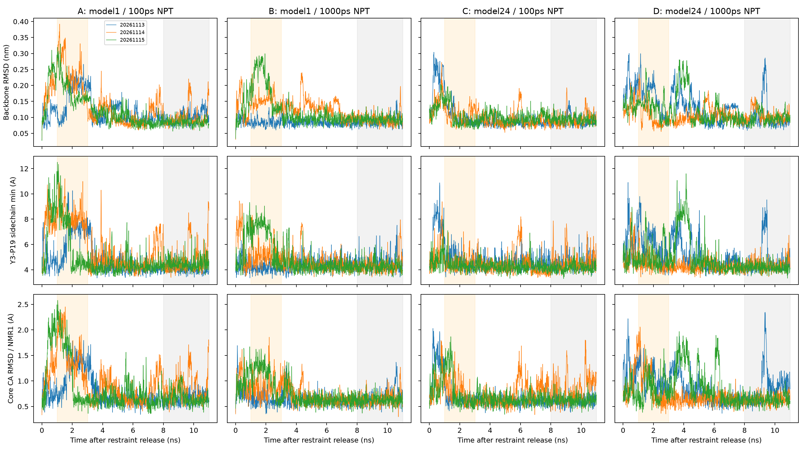

# 计算结构生物学方法验证与敏感性分析

以共晶重对接、短肽分子动力学和结构预测为三个练习，展示从输入检查、异常发现到对照实验、独立数值核验的完整过程。个人学习项目；不代表药物研发管线、产业经验或结合机制研究。三个模块并非同一药物体系。

[三页技术报告](output/pdf/method-validation-report.pdf) · [详细报告](report/技术报告.md) · [复现指南](REPRODUCING.md) · [简历与面试说明](report/简历与面试话术.md) · [版本与证据包](https://github.com/LessRAY3-3/method-validation-mini/releases/tag/v1.0.0-method-validation)

## 已完成的实验

| 模块 | 规模与结果 | 解释边界 |
|---|---|---|
| AutoDock Vina | 1IEP：3档搜索强度 × 5个配对种子，15次运行、57个保存姿势；Top-1重对接成功数为1/5、5/5、5/5 | 同一体系，不能外推跨靶点准确率；最低分不等于正确姿势 |
| GROMACS | 六条初速度重复后开展起始结构及其准备体系 × 有约束NPT时长的四格对照；四格每格3条、每条11 ns，共132 ns | 短/长分支共享历史，每格n=3；不证明热力学收敛或真实折叠机制 |
| ColabFold / ESMFold | 基础预测与置信度解读；3种MSA × 6个种子主比较，另5次定向复测、1次recycle坐标追踪 | 输入处理敏感性案例，不是训练集外评测，不能推断“MSA有害” |

**MD数量口径：**最初探索三条33 ns；新种子验证三条33 ns；四格对照复用新种子验证三条作为A组，并新增B/C/D九条99 ns。因此四格主体为12条132 ns，全部正式生产累计15条165 ns；不是一条165 ns轨迹，也不是15个独立起始构象。历史CPU单轨迹和平衡阶段不计入该总量。

## 核心案例：发现差异，再检验解释

1. 原三条MD中发现一条早期几何偏离；复核原子选择、叠合参考、接触定义和时间窗口。
2. 冻结分析后增加三个速度种子，发现类似早期偏离并非原种子独有。
3. 开展四格对照：原NMR model 1 / 另一NMR model 24，分别进行100 ps / 1000 ps有位置约束NPT，然后各11 ns无约束生产。
4. 比较全部分支、38个NMR参考与接触阈值网格，保留反向重复。

预定1–3 ns窗口的Y3–P19侧链最短距离，先求每条时间均值，再对每格三条取平均：

| 起始结构及其准备体系 | 100 ps NPT | 1000 ps NPT |
|---|---:|---:|
| model 1 | 7.06 Å | 5.29 Å |
| model 24 | 4.49 Å | 5.13 Å |

**在本次样本中，延长有约束NPT的影响方向依赖准备体系。** 不能概括为“平衡越久越好”；原起点的一条重复局部偏离反而增加。两个起点重新溶剂化，水数及离子放置不同，因此不能解释为纯粹的蛋白起始构象因果效应。末段曲线接近也不能证明收敛。

详细证据：[四格结果与反例](report/MD四组对照结果解读.md) · [执行记录](report/MD起点与平衡对照执行记录.md) · [新种子验证](report/MD新种子验证批次.md)。

对接专题：[配对种子重对接](report/对接配对种子实验.md)。预测专题：[MSA异常与干预](report/MSA异常深挖报告.md)、[源码诊断](report/MSA源码诊断.md)。

## 如何核验

- **只读检查小型结果：**不需要GPU或下载原始轨迹，入口和依赖见[复现指南](REPRODUCING.md)。
- **从原始MD重新分析：**下载版本附件中的证据包，先验证SHA-256，再在独立目录解压；需可读原始TPR的GROMACS。
- **重新执行实验：**需要软件、模型权重及计算资源，按冻结参数和实际环境记录重建。不同硬件/软件不保证逐位相同的轨迹或预测。

已完成的审核包括57个对接姿势双实现RMSD核验、MD轨迹/输入/输出哈希检查，以及M3对四格12条坐标的独立解析和数值复算。M3核验覆盖5472个参考标量、171756个逐帧指标和全部Q/接触/阈值统计；这是后处理数值核验，不是独立动力学复跑或独立PBC导出验证。

仓库保存代码、参数、结构输入、小型结果、测试与报告；大体积MD轨迹、TPR和检查点通过版本证据包提供。证据清单不是数据下载本身；附件范围、校验值、下载步骤见[复现指南](REPRODUCING.md)。原始方法、错误修订与历史结果保留于[审核记录](report/审核修订记录.md)及`report/legacy/`，不能混作当前实验结果。
