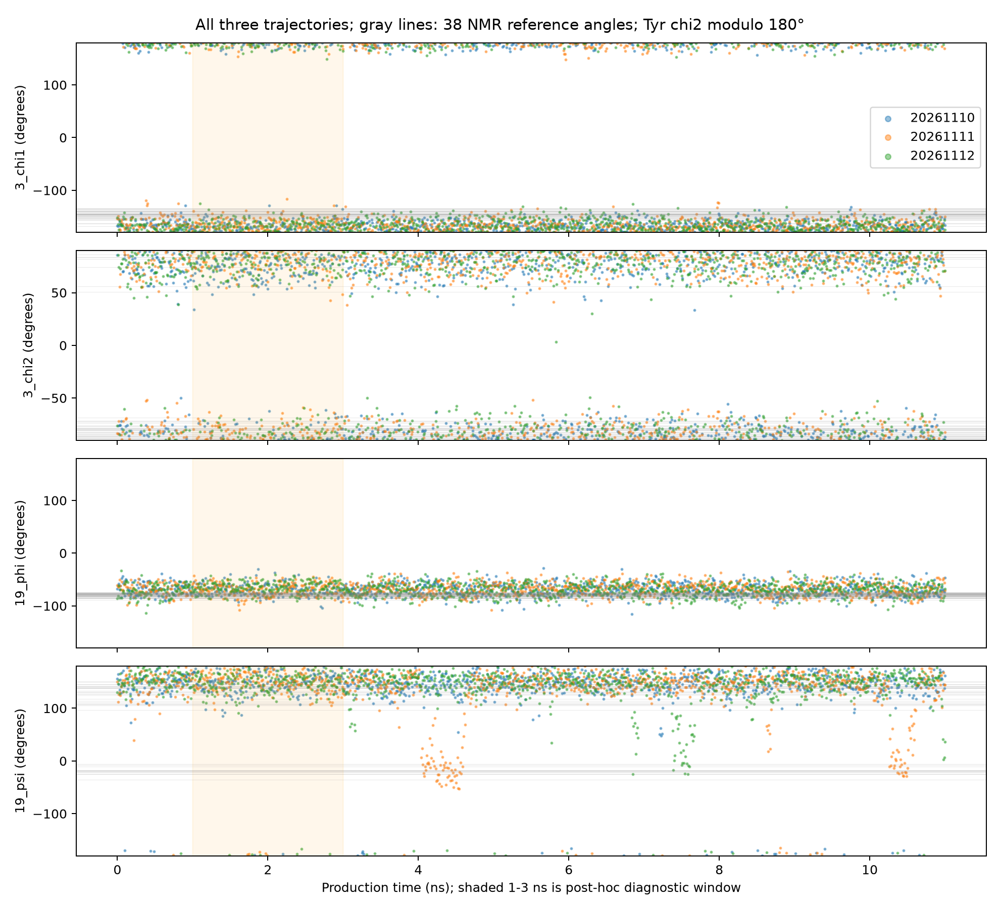
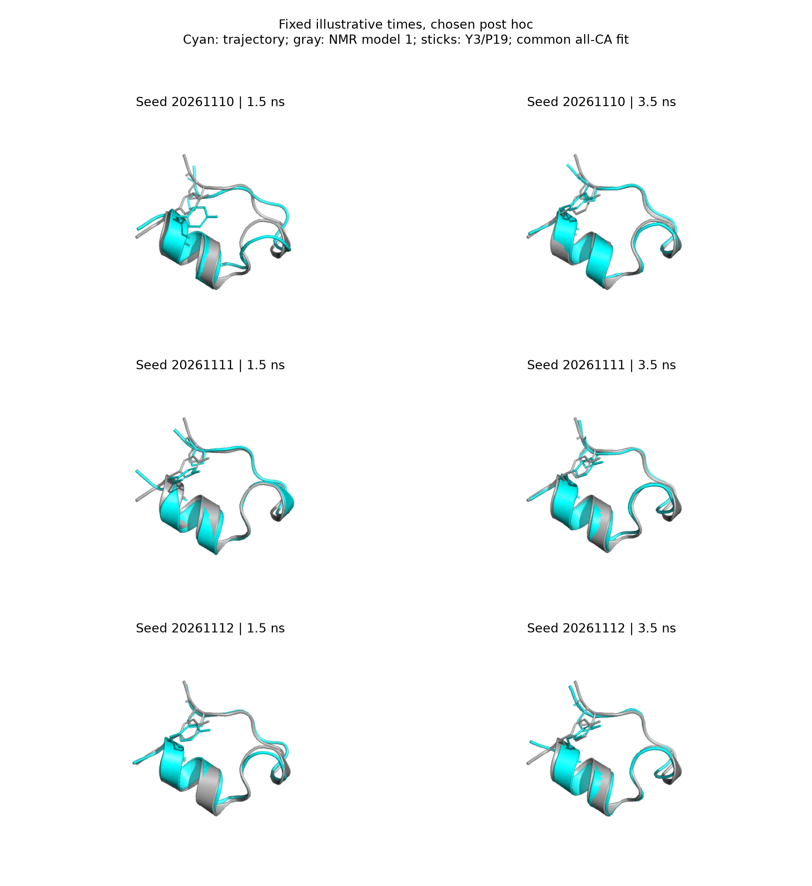

# MD局部二面角与固定时刻结构快照

2026-11-10。本专题是观察到seed20261110早期偏差后的探索性分析；没有新模拟，没有选取有利重复。三条都计算全残基可定义的φ/ψ、Y3及W6的χ1/χ2，使用相同0–1、1–3、3–8、8–11、0–11 ns窗口；内部窗左闭右开，最后包含11 ns。输入来自审核版完整蛋白GRO，保留原0.001 nm坐标精度。

## 要检验的简单解释

第一条早期Y3–P19侧链距离更大，是否只是Y3侧链换了一个明显不同的转子构象？若该解释足够，Y3的χ角应出现与早期分离对应的明显变化。这里检验的是可观察的几何伴随关系，不是分子运动的因果证明。

角度必须按周期处理：φ/ψ及一般χ角为360°，Tyr芳环χ2按180°处理，避免把芳环等价原子标记的翻转当成不同取向。输出圆均值与圆合向量长度R（0表示分散/抵消，1表示集中）；R不是置信度。NMR对照保存全部38模型，最近参考角偏差只是描述性最小差，不是实验置信区间。

## 结果：不支持单一Y3大转子切换的解释

| seed | 1–3 ns Y3 χ1圆均值 | 3–8 ns χ1 | 1–3 ns Y3 χ2圆均值（180°周期） | 3–8 ns χ2 |
|---|---:|---:|---:|---:|
|20261110|−171.47°|−171.27°|79.10°|84.74°|
|20261111|−166.92°|−171.09°|87.77°|86.34°|
|20261112|−171.05°|−167.42°|83.36°|86.42°|

第一条Y3 χ1早期到后续几乎没有圆均值变化，R约0.98；χ2有约5.6°变化，R约0.87–0.88，但未见与几Å侧链距离分离相对应的独特大转子转换。W6 χ1在三条中也均集中于约±180°附近，χ2均在约73–81°，没有仅第一条出现的大转子切换。这不证明侧链毫无贡献，只说明“Y3一个大转子改变解释全部现象”缺乏支持。

第一条1–3 ns到3–8 ns，骨架φ/ψ圆均值变化最大的角为G10 φ（14.7°）、G11 ψ（11.9°）、N1 ψ（11.5°）、S13 ψ（10.8°）。第二、三条有些局部角变化反而更大，例如第二条L2 φ约30.6°、第三条G10 φ约22.2°。因此不能只挑第一条一个二面角并把它宣称为特殊失稳机制。多个适度角度变化、不同片段相对位置和末端几何都可能影响长程距离；需要和无拟合距离矩阵、逐接触图一起解释。

P19 φ/ψ三条大部分处于相近角度范围；第二、三条后期ψ还有短暂不同取值，第一条并不在所有局部指标上都“最异常”。这些变化不能当作折叠状态转变次数或速率；只有10 ps采样且总时长11 ns。

## 固定时刻快照

三条都导出1.5和3.5 ns，用全部20个Cα拟合同一NMR模型1，保存全部原子PDB及PyMOL脚本。时间是在看到早期偏差后选定，用于解释，不是独立验证或最大偏差帧。所有画面使用同一视角；青色为MD，灰色为NMR1，Y3/P19画作棒状。真实坐标直接渲染，没有生成式图像。

单张静态视图不能代替时间序列，也不应从视角遮挡判断接触是否存在；局部距离以已导出的数值为准。

## 核验与复算

全42个可定义角度×三条×五个固定抽帧，共630项与Bio.PDB calc_dihedral独立核验，圆周期差均小于1e-8°。三个单元测试覆盖周期边界/芳环等价、圆均值、刚体不变性及退化几何拒绝。

- `scripts/analyze_md_torsions.py`：无动力学，仅读取保存轨迹；完整结果目录已存在时拒绝覆盖。
- `results/md_deep_dive/torsions/protocol.json`：探索性设计、时间窗与精确原子定义。
- `window_torsion_summary.csv`、`seed_*_torsions.csv`、`nmr_torsions.csv`：全角度、全seed、全窗口及全部参考值，未只导出支持故事的角度。
- `scripts/render_md_torsion_snapshots.py`：用已有PDB/PML重新渲染六张固定快照，不运行MD。

最窄结论：本次第一条早期距离分离没有对应一个明显独特的Y3大转子切换；目前更应以整体/片段相对几何变化描述，不能由相关性确定因果，更不能宣称折叠机制。
