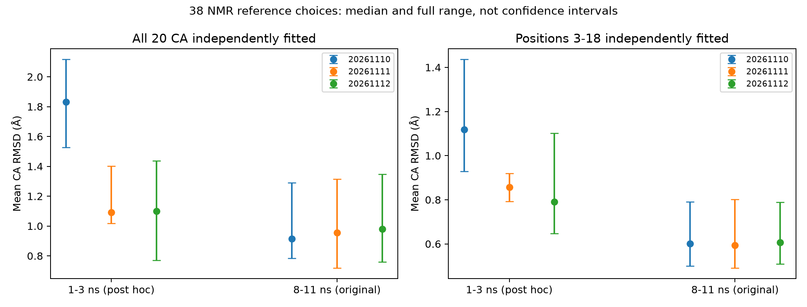

# MD偏离是否依赖选了哪个NMR参考？

2026-11-10。本轮针对已观察到的第一条早期偏离做后验探索；窗口0–1、1–3、3–8 ns由观察后选定，8–11 ns保留原预定窗口。没有重新模拟，没有把38个NMR模型算作38个独立重复。

## 方法

对三条轨迹全部1101帧分别使用全部38个NMR模型作为参考，计算三类指标：

1. 全20个Cα各自最优旋转平移拟合后的RMSD。
2. 仅3–18位Cα独立拟合的RMSD；该范围是去除两端的位置选择，不等于定义疏水核心。
3. 序列间隔至少3位的Cα内部距离与参考距离的平均绝对误差，无需任何空间拟合。

每个参考先计算每条轨迹的窗口时间均值，再做同参考下的轨迹比较。保存全部结果，不挑最有利NMR模型。342个抽帧/参考组合另用Bio.SVDSuperimposer核验，最大差1.78e-15 Å。

## 结果

下表表示第一条均值同时高于第二、第三条的参考模型数。分母38是参考选择数量，不是成功率或统计独立样本数。

| 窗口 | 全Cα RMSD | 内部3–18 RMSD | 无拟合内部距离MAE |
|---|---:|---:|---:|
| 0–1 ns | 0/38 | 0/38 | 0/38 |
| 1–3 ns | 38/38 | 38/38 | 38/38 |
| 3–8 ns | 2/38 | 4/38 | 1/38 |
| 8–11 ns | 8/38 | 8/38 | 7/38 |
| 全0–11 ns | 38/38 | 33/38 | 14/38 |

1–3 ns中第一条全Cα RMSD均值比第二条高0.418–1.005 Å，比第三条高0.527–0.889 Å；内部独立拟合与无需拟合的距离MAE也在全部参考选择下保持同方向。这个早期偏离不是只因挑了NMR模型1或只因两端影响全局叠合。

0–1 ns中第二条的全Cα/内部拟合偏差反而更大，不能笼统说第一条从一开始就始终最差。3 ns之后，三条的细微排序随参考改变。全程无拟合MAE只有14/38保持第一条最高，说明“全程各指标一致更差”也不成立；1–3 ns是最稳健的局部时间范围。

图中误差棒是38个参考选择下的全部范围，不是置信区间。各参考都是同一实验结构集合的成员，不能当作独立实验、热力学分布或总体结构容许区间。

## 支持的最窄结论

**在现有三条同起点、不同初速度轨迹中，第一条在1–3 ns出现对参考选择和拟合方式较稳健的整体及内部几何偏离；后续三条没有参考无关的严格优劣排序。** 这支持描述短时构象差异，不证明状态转换、解折叠、动力学机制或收敛。

源码与结果：`scripts/analyze_md_reference_ensemble.py`；`results/md_deep_dive/reference_ensemble/`内有运行前探索声明、全部参考/窗口CSV、成对差值、输入/脚本哈希。脚本拒绝覆盖已有输出。
