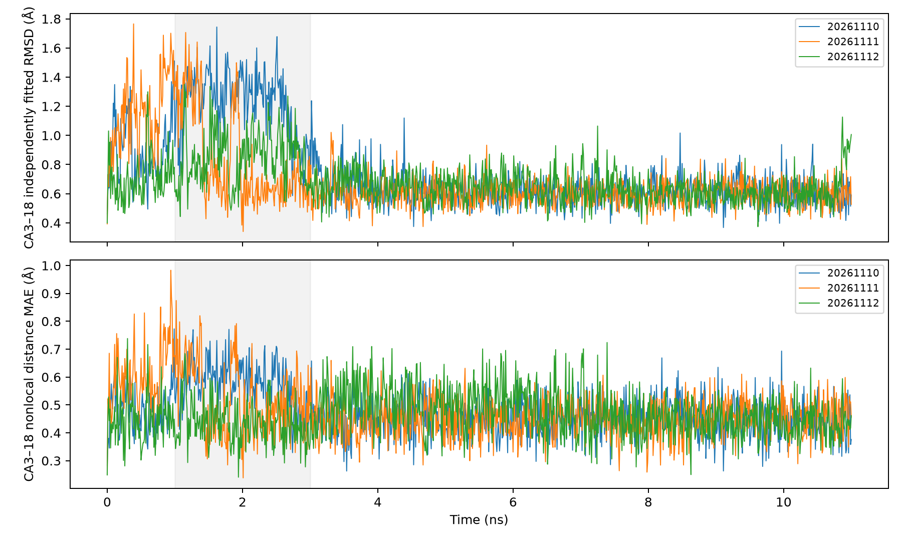
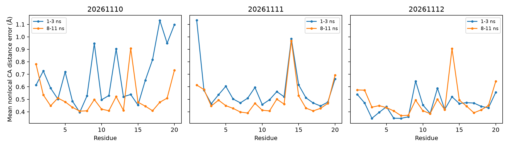
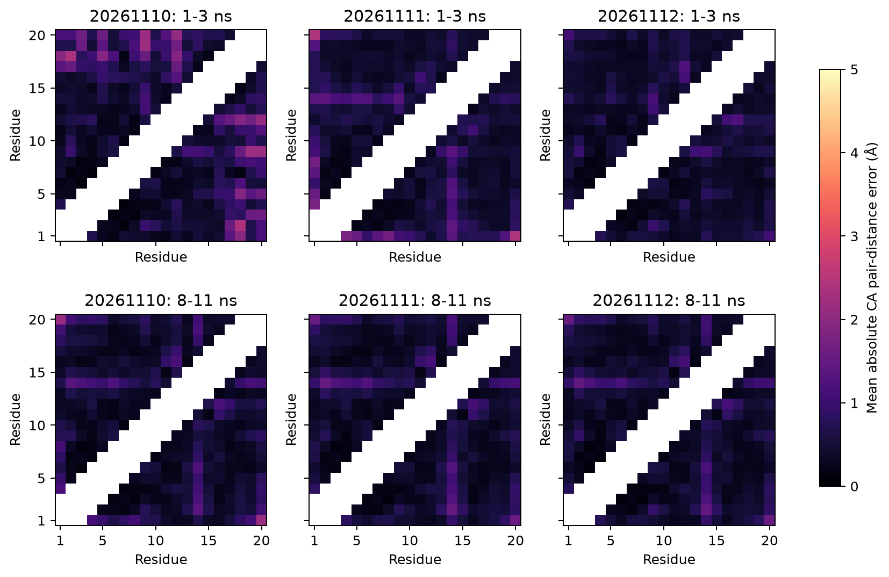

# MD早期差异的局部几何深挖

2026-11-10。分析现有三条11 ns轨迹，不新增动力学模拟、不修改原结果。本轮是在已观察第一条1–3 ns偏离后开展的**探索性定位**，不是事先独立验证。开始分析前将本轮窗口、指标和输入哈希写入[`plan.json`](../results/md_deep_dive/local_geometry/plan.json)。三条轨迹使用相同规则，保留全部残基对，而不是只展示支持叙述的接触。

## 能加强到什么程度

第一条早期偏差不仅来自末端或全局叠合方式：仅对3–18位Cα独立拟合，偏差仍较高；不需要任何叠合的内部距离误差也较高。局部变化包含C端区域相对其他残基的重新排列，部分距离增加、部分缩短，不能把它概括成整个短肽均匀张开。Y3–P19与P12–P18的Cα参考接触在第一条早期较少保持、末段大多保持；另外两条同期保持率更高。这加强了对第一条特有几何变化的定位，但仍不证明因果机制、解折叠或热力学状态转换。

## 1. 检查是否是末端或拟合假象

参考均为NMR模型1。全Cα与3–18位Cα各自独立做proper Kabsch拟合；内部距离误差只使用两端均位于3–18、序列间隔≥3的残基对，是与旋转平移完全无关的指标。

| seed | 1–3 ns 全Cα RMSD Å | 内部3–18独立拟合 RMSD Å | 内部距离MAE Å | 8–11 ns内部拟合 RMSD Å | 末段内部距离MAE Å |
|---|---:|---:|---:|---:|---:|
|20261110|1.845|1.227|0.575|0.617|0.451|
|20261111|1.098|0.828|0.515|0.604|0.455|
|20261112|0.956|0.853|0.436|0.616|0.440|

因此“仅末端摆动或全局拟合造成第一条异常”的解释不足。末段内部指标接近，但它们都非零，不表示精确回到参考坐标。第一条内部距离MAE相对第二条的差别并不巨大，不能只用RMSD的较大差别夸大结构破坏。

## 2. 差异具体分布在哪里

全体非邻近Cα残基对的距离误差按每个残基关联的伙伴数取平均。第一条1–3 ns较高的残基包括P18（1.130 Å）、S20（1.097 Å）、P19（0.949 Å）与D9（0.946 Å）。这里是相对参考距离的描述性贡献排名，不是各残基因果重要性。各残基可配对数量不同，文件同时保存伙伴数。

距离的方向更有解释力：第一条1–3 ns中，2–18平均距离比参考**缩短2.368 Å**，9–19缩短2.192 Å，而12–20**增大2.078 Å**。这些结果说明相对排列改变，不能简单说“末端整体远离核心”或“整体膨胀”。所有距离及有符号误差见`all_pair_distance_errors.csv`。

第二条早期较突出的偏差在N1和S14；第三条整体较小。S14的平均非邻近距离误差在末段仍较突出（图中约0.9 Å），不是第一条独有，也不是所有残基末段都更接近NMR模型1。第三条全体非邻近距离MAE由早期0.456 Å变为末段0.480 Å，因此不能把“每条、每项指标都改善”写成结论。

热图空白带为序列间隔小于3、不参与统计的残基对，并非缺失数据。各图使用共同色标。

## 3. 哪些参考接触发生变化

这里的接触是**Cα几何接触**，不是侧链最短距离、氢键或已确认化学相互作用。使用NMR模型1的Cα距离≤8 Å建立集合；轨迹距离≤参考距离1.2倍计为保持。占有率为窗口内保存帧满足条件的比例，不能当独立事件频率或平衡概率。

| seed | Y3–P19早期1–3 ns | Y3–P19末段8–11 ns | P12–P18早期 | P12–P18末段 |
|---|---:|---:|---:|---:|
|20261110|21.0%|100.0%|25.5%|98.0%|
|20261111|100.0%|100.0%|98.5%|99.3%|
|20261112|100.0%|100.0%|95.5%|99.3%|

第一条这两个接触的早期低保持率，与先前观察到的Y3–P19侧链距离增大相容；两种原子选择提供相互补充的几何描述，但都来自同一轨迹，不是独立实验验证。阈值定义允许比参考更短的距离计为保持，因此“100%保持”也不表示距离分布完全等于参考，更不证明侧链几何正确。

窗口间占有率差异是本轮事后描述，不报告把帧当独立样本的显著性检验。全部7/8/9 Å集合、所有参考接触及全部窗口值分别写入`all_contact_occupancies.csv`、`all_contact_early_late_contrasts.csv`。

## 4. 参考接触集合阈值敏感性

第一条在1–3 ns的Q7/Q8/Q9分别为0.893/0.890/0.918，末段为0.937/0.950/0.968；三种参考集合下方向相同。另两条早期Q8为0.929/0.946，末段0.964/0.972。8 Å并非唯一产生上述整体模式的集合阈值。

这一检验改变的是**哪些参考接触进入集合**，不是接触保持判据的1.2倍系数。P12–P18参考距离7.540 Å，不进入7 Å集合，不能声称该具体接触在全部阈值中均被检验。对1.2倍保持阈值、其他NMR参考和时间统计的敏感性需另列结果。

## 可复算与核验

- 脚本：`scripts/analyze_md_local_geometry.py`；默认只做已有坐标的分析，输出目录存在时拒绝覆盖，不运行模拟。
- 输出：`results/md_deep_dive/local_geometry/`；0–1、1–3、3–8、8–11 ns及0–11 ns全部保留，内部窗口左闭右开，11 ns端点包含一次。
- 全部坐标读取前后哈希一致；每条0、1.5、11 ns分别用Bio.SVDSuperimposer检验全Cα与内部拟合，共18项误差小于1e-10 Å；另显式逐分量核验选定残基距离。
- 两项测试验证整体旋转平移不变性，以及人为扭曲末端不会污染内部独立拟合/内部距离指标。三张图已目视检查。
- 这些是同一三条短轨迹的多种描述，不能因图表增多就增加独立样本量。定位结果适合提出下一轮要检验的假设，不足以单独确定原因。

## 补充：接触保持因子敏感性检验

随后新增独立脚本`analyze_md_contact_sensitivity.py`与补充探索协议，原方案/输出不变。在相同三条轨迹、相同全部窗口上，交叉使用参考cutoff=7/8/9 Å与保持因子=1.1/1.2/1.3，共九种定义。此处仍是事后稳健性检验，不是九次独立实验。

| 参考cutoff Å | 保持因子 | 第一条早期Q | 第二条早期Q | 第三条早期Q | 第一条末段Q |
|---:|---:|---:|---:|---:|---:|
|7|1.1|0.7958|0.8052|0.8236|0.8443|
|7|1.2|0.8930|0.9080|0.9316|0.9367|
|7|1.3|0.9690|0.9496|0.9842|0.9858|
|8|1.1|0.7647|0.8300|0.8264|0.8357|
|8|1.2|0.8898|0.9291|0.9461|0.9503|
|8|1.3|0.9653|0.9618|0.9880|0.9891|
|9|1.1|0.8049|0.8532|0.8599|0.8867|
|9|1.2|0.9176|0.9505|0.9628|0.9681|
|9|1.3|0.9765|0.9756|0.9920|0.9931|

**得到的反证：第一条早期Q只在6/9种定义下最低。** 保持因子放宽到1.3后，三个参考cutoff下第二条Q均低于第一条。因此不能声称第一条在任意接触定义下都最差。较宽松定义下Q普遍接近1，细小排序变化不应被夸大。

**仍稳健的方向：第一条末段Q在9/9种定义下均高于其早期值。** 第一条Y3–P19在各包含定义中的早期占有率范围13.0%–68.5%，末段97.7%–100%；P12–P18分别11.5%–63.5%、68.1%–100%，每一个配对定义的末段值都高于早期。绝对占有率明显依赖保持因子，不能只展示默认1.2的数字而声称与阈值无关。

P12–P18参考Cα距离为7.540 Å，在cutoff=7 Å时均标记`excluded`、JSON占有率为null、CSV为空，而不是0%；Y3–P19参考距离6.326 Å，包含在全部三个集合中。选择排除与接触未保持是不同含义。

所有三条×五窗口×九定义的Q及选定位点占有率见[`contact_sensitivity`](../results/md_deep_dive/contact_sensitivity/)。每条在1.5 ns对九种定义用独立逐分量距离/显式残基循环核验，共27项均一致。最窄结论应为“第一条早期发生可定位的内部几何偏离，随后参考接触保持增加；相对另外两条的Q排名依赖定义”，而非“第一条普遍更不稳定”或“已证明某个接触导致结构变化”。
