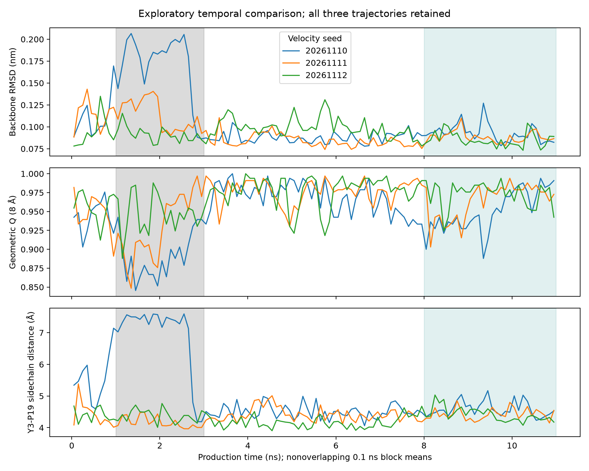
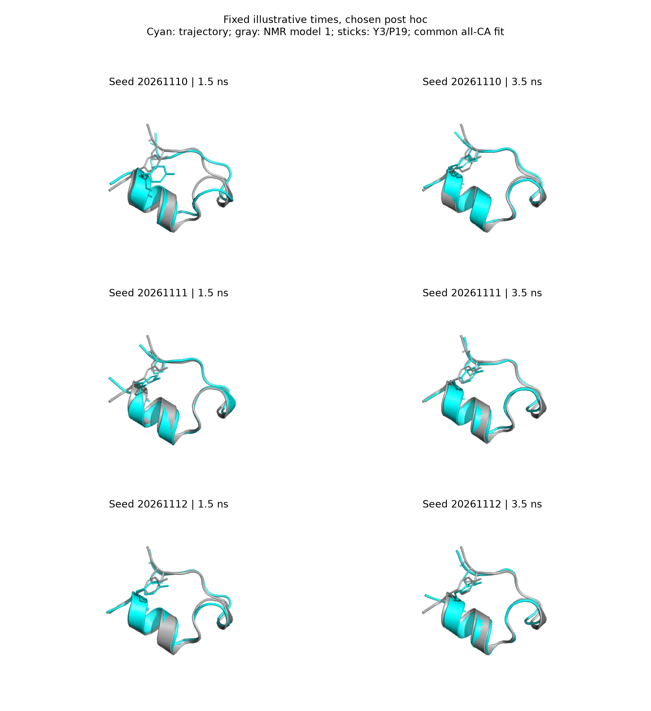

# MD重复间差异：从现象到可检验的解释

2026-11-10。本轮只深挖已有三条11 ns轨迹，没有新增MD、改变力场或删除偏离帧。全部新窗口、阈值和定位工作明确为观察原结果后的探索，不能把同一数据的多种分析写成独立验证。

## 现在可以更有把握地说什么

**第一条在约1–3 ns存在真实的短时几何偏离，涉及多个片段的相对排列和部分长程接触减少；这一偏离不是单个尖峰、末端拟合假象或只选NMR模型1造成的。随后几何偏差减弱、相关接触保持增加。但总体Q的轨迹排序依赖阈值，数据也不支持用一个Y3大转子切换解释整个现象。**

这里“真实”仅指保存模拟坐标中可复算、对若干分析选择稳健的现象，不是已经得到实验验证的真实生物动力学。

## 五项检验及其边界

| 想排除的解释 | 实际检验 | 结果与能支持的结论 |
|---|---|---|
| 只是选了某个有利参考 | 三条分别对全部38个NMR模型拟合；不选择最低误差模型 | 1–3 ns第一条全Cα、内部3–18拟合RMSD及无拟合距离误差均在38/38参考下高于其余两条；末段细微排名则随参考改变 |
| 只是末端拖动全局拟合 | 去掉1–2、19–20位后独立拟合，并直接比较内部距离 | 1–3 ns内部RMSD为1.227/0.828/0.853 Å，无拟合内部MAE为0.575/0.515/0.436 Å；内部确有差异，但不是均匀膨胀 |
| 只是少数噪声帧 | 0.1/0.5/1 ns完整块，以及侧链距离5/6/7 Å敏感性 | 第一条>6 Å连续保存帧覆盖1.12–2.68 ns，其余两条最长20 ps和单帧；阈值改7 Å后最长跨度仅0.23 ns，不能当固定状态寿命 |
| 任何接触定义都能给同样排名 | 参考集合7/8/9 Å × 保持因子1.1/1.2/1.3 | 第一条早期Q仅6/9种定义最低；factor1.3时排名反转。但第一条末段Q在9/9均高于早期，两处选定位点恢复方向也稳健 |
| 一个侧链大翻转解释所有变化 | 全骨架φ/ψ、Y3/W6 χ角圆统计、真实坐标快照 | Y3 χ1早期/3–8 ns约−171.47/−171.27°，无独特大转子切换；其他轨迹部分骨架角变化更大，不支持单角度机制故事 |

38/38和9/9是分析选择下的描述结果，不是独立样本或显著性检验。角度没有大均值变化也不证明每帧不变，更不排除多个适度角度变化的共同影响。

## 结构上发生了什么

原8 Å/1.2倍定义下，第一条Y3–P19 **Cα几何接触**占有率从1–3 ns的21%升至8–11 ns的100%；P12–P18从25.5%升至98.0%。另两条早期这两处接触已大多保持。此处Cα接触与侧链最短重原子距离是两种不同指标，均不是化学键或亲和力。

第一条并非整体向外张开：一些残基对变近，例如2–18、9–19；另一些变远，例如12–20。更合适的描述是多处相对排列改变。第三条某些距离误差末段并未下降，S14末段误差偏高也是三条共有现象，不能只挑第一条支持故事。

第一条侧链距离与主链RMSD全程相关r=0.867，但末段降至0.324，另两条全程仅0.070/0.025。强相关主要与这段共同变化相伴，不支持三条共有的“距离变化导致骨架偏离”机制。

## 还不能升级成什么结论

不能称为发现稳定中间态、完整解折叠/再折叠事件、折叠速率、药物作用机制或采样收敛。只有三条同起始构象的短轨迹；第一条出现一次并不等于事件概率1/3。相邻帧有相关性，末段仅3 ns不足以可靠估计复杂慢过程；块平均不能把相关帧自动变成独立实验。[分子模拟不确定性与采样质量实践指南](https://pmc.ncbi.nlm.nih.gov/articles/PMC6286151/)强调应检查相关性、块长依赖和起点依赖，不能仅凭平台判断充分采样。

## 最值得做的下一轮

若问题是“这样的早期偏离是否可在更多随机初速度中出现”，优先新增预先固定的三个seed20261113/14/15，每条同样100 ps NVT、100 ps NPT和11 ns生产。沿用同起点、环境和分析方法，冻结当前脚本哈希；先独立报告新增三条，再与原三条并列。主比较保留完整0–11 ns与预定8–11 ns；由本轮提出的1–3 ns窗口明确作为待检验的新假设。Q同时报告完整阈值网格，不根据新结果改变有利阈值。

若问题是“已经偏离后返回的轨迹会不会再次出现类似片段”，则三条统一从原检查点延长到20 ns，新增27 ns生产量；预先固定11–20和17–20 ns新数据窗口。保持旧11 ns证据和原随机状态，不重新生成速度，不仅延长第一条。三条延长仍是n=3；没有再次出现也只说明新增有限时间内未观察到。

两种设计回答不同问题。**建议优先增加三个初速度重复，再视新的跨seed结果决定是否延长。** 再往后的起始构象敏感性应单独设实验，例如不同NMR模型×配对种子，不能把不同起点和不同seed混成一组后直接归因。

以上仅为待执行方案，记录在`config/experiments/md_followup_proposed.json`；本轮没有启动新模拟。

## 可核验交付

- [局部几何与阈值敏感性](MD局部几何深挖.md)：全部残基对、接触占有率、7/8/9 Å × 1.1/1.2/1.3网格，含排名反转。
- [时间尺度与稳健性](MD时间尺度与稳健性.md)：全部阈值连续采样段、完整块均值、自相关和描述相关。
- [38参考敏感性](MD参考选择敏感性.md)：全部参考/seed/窗口，不挑最佳参考。
- [二面角与结构快照](MD二面角与结构快照.md)：全部42角、圆统计和六张同视角真实坐标快照。

各模块保存输入哈希与探索协议；独立核验包括342个参考拟合、18个局部拟合、27个接触循环及630个二面角计算。它们检验分析实现，不增加动力学独立样本数。
