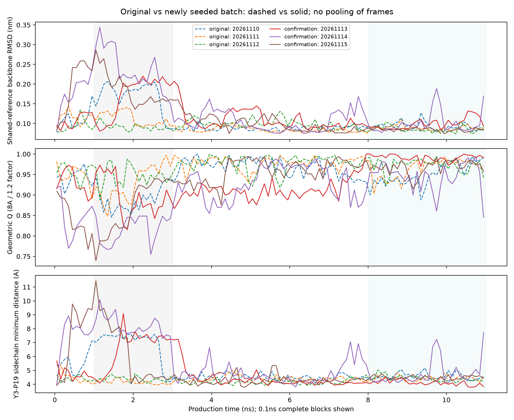

# MD新种子验证批次：执行记录

用户在查看原三条的探索性深挖后，授权执行新增三个初速度seed。2026-11-10晚间已冻结分析并启动；本文的启动快照不代表计算完成，当前进度用`python3 scripts/remote_compute_status.py --host win4070`查询。

## 完成状态（2026-11-11本地核验）

新增三条生产及独立分析于2026-11-10 23:54:49（Asia/Shanghai）完成，新旧批次自动比较约23:54:56完成。六条正式轨迹合计66 ns生产量，分为原三条与新三条两批，不含历史探索轨迹和平衡时间。新增三条各5500000步、1101帧，LINCS/fatal均0；已回传三条XTC/TPR并核验全部6个哈希及36个分析输出文件哈希，对照图表哈希也通过。

下表为本轮冻结的1–3 ns与8–11 ns窗口各自时间均值：

| 新seed | 1–3 ns主链RMSD nm | 1–3 ns Y3–P19侧链距离 Å | 8–11 ns主链RMSD nm | 8–11 ns侧链距离 Å |
|---|---:|---:|---:|---:|
|20261113|0.1696|6.6247|0.0989|4.1022|
|20261114|0.2387|8.2427|0.1007|4.7930|
|20261115|0.1864|6.2993|0.0844|4.4917|

三条在预定1–3 ns窗口都出现比其末段更大的骨架偏差、侧链距离；早期侧链>6 Å样本比例分别71%、100%、42.5%。这支持类似几何偏离不只出现在原seed20261110，不能声称整个原轨迹逐帧复现，也不能把小样本比例解释为总体发生概率。

新seed20261114末段仍有13.29%的样本侧链距离>6 Å，最长连续保存样本跨度0.25 ns；其余两条末段比例为0%与1.33%。因此不能说六条最终完全一致，或偏离此后不会出现。六条仍共享一个最小化起始构象，现有结果无法区分共同起点的短时调整与更普遍的动力学行为，也不证明收敛或折叠机制。

完整数据：`results/md_replicates_gpu_confirmation/confirmation_analysis/`；新旧分批统计与六条附加描述见`results/md_confirmation_comparison/`。三页PDF仍是上一轮三重复摘要，未将本轮新结果自动写成最终稿。

## 新批次检验什么

原三条中第一条1–3 ns出现较明显几何偏离，涉及Y3–P19等局部距离；已有分析排除若干参考/拟合假象，也发现总体Q排名依赖阈值。本轮检验在**同一最小化起始构象**下，这种表现是否在新的随机初速度中再现。

seed固定20261113、20261114、20261115，各100 ps NVT、100 ps NPT及11 ns生产，共新增33 ns生产量。沿用原Ubuntu GROMACS2026.3 CUDA、同一力场、水模型、拓扑、起点和共同分析参考。没有同时执行原三条延长到20 ns的替代方案。

三条全部运行，不因初步结果好坏改种子或延长某条。当前协议不定义事后“成功/失败”标签；保留所有连续指标与阈值结果，不能把未复现某段变化解释成它永远不会发生。

## 启动前冻结和验证

- 冻结协议：`config/experiments/md_confirmation_protocol.json`，SHA-256 `f315904d13cdad5a98a6d053041e54439879a9acb32cfd6bdf973638c4bcc821`。
- 固定窗口0–11、1–3、8–11 ns；1–3来自旧数据探索，但在新数据产生前固定。内部窗口左闭右开，末端11 ns包含一次。
- 固定全部38个NMR参考、真实侧链距离>5/6/7 Å的样本比例和连续采样跨度、参考接触7/8/9 Å × 保持因子1.1/1.2/1.3；参考中未选入的接触明确为excluded/null。
- 9份输入和5份执行/分析源码逐一哈希锁定，并保存源码副本。队列各seed之间及分析前重新核验，发现变更即停止。
- 新分析接口先用旧三条完整轨迹试算；342条参考结果、81条Q网格、162条位点接触与原分析完全一致。启动前43项测试通过。
- 4070预检空闲，旧批次complete，新输出目录不存在；新增Biopython1.88仅用于独立后处理核验，安装前后GROMACS实际二进制哈希一致，不升级动力学软件。

## 实际启动与输出

队列于2026-11-10 23:21（Asia/Shanghai）启动，PID4536。首seed已完成NVT和NPT并进入生产；首快照378 ps，GPU PP/PME使用确认，无LINCS/fatal。该快照仅说明启动正常，不是完整11 ns验收。

远端根目录：`/home/lessray/codex-runs/method-validation-20261110-gpu`。

- 新轨迹：`results/md_replicates_gpu_confirmation/seed_*/`。
- 新批次独立分析：`results/md_replicates_gpu_confirmation/confirmation_analysis/`。
- 队列状态：新批次根下`queue_status.json`；日志`setup/confirmation/queue.log`。
- 原批次完整保留在`results/md_replicates_gpu/`。
- 对照程序`compare_md_confirmation_batches.py`先核验新三条完成及输出哈希，再分别报告旧、新各三条，六条合并仅作为附加描述。

启动前协议固定的是科学指标。新旧批次对照与绘图程序作为独立后处理，源码另存哈希，不修改正在运行的冻结队列。

## 完成后怎样判断

先报告新增三条各自的完整时间序列和固定窗口结果，再与旧三条按相同口径并列。重点看偏离是否再现、是否仍集中在1–3 ns、局部几何是否相同，以及参考/阈值变化是否改变解释。不只寻找与旧异常相似的一条，也不把没出现偏离的轨迹删掉。

无论结果如何，统计单位是轨迹；NMR参考、时间窗和帧数都不能增加独立样本量。不同速度仍共享同一初始构象，不能推广为跨起点稳定性、折叠概率或热力学收敛。
