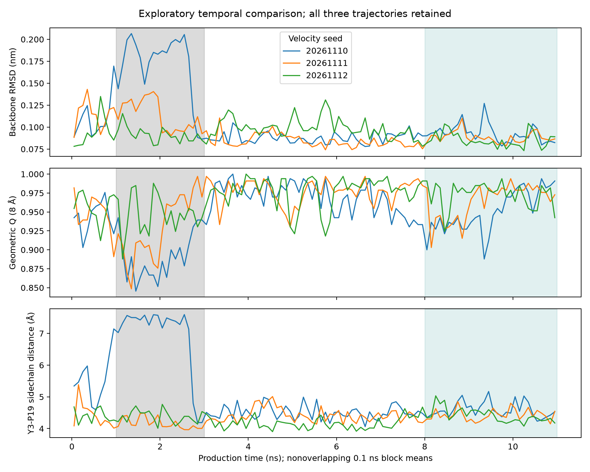
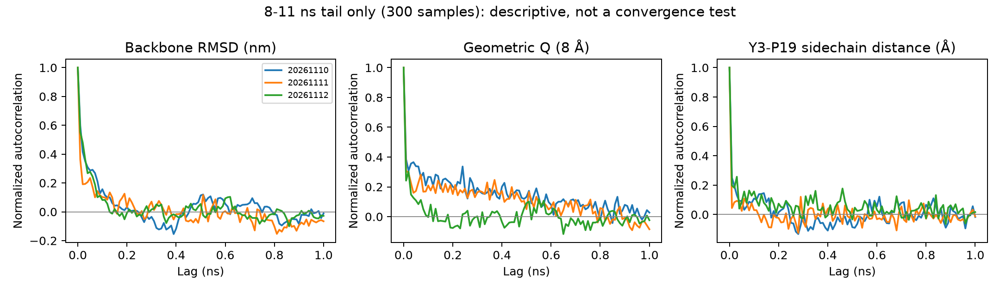

# MD差异的时间尺度与阈值稳健性

2026-11-10。仅分析已有三条11 ns轨迹，无新模拟。输入是审核后的逐帧CSV，原始轨迹不修改；脚本为`scripts/analyze_md_temporal_robustness.py`，全部结果在`results/md_deep_dive/temporal/`。

## 探索性质与分析口径

已知seed20261110早期偏离后，先保存本轮探索协议，再计算时间分段、阈值敏感性和自相关。新增1–3 ns等窗口是观察后的描述性选择，不是独立验证或预注册发现；原正式实验8–11 ns窗口保持不变。三条使用同一套窗口/阈值，完整导出所有结果，统计单位仍为轨迹n=3。

全程与窗口均采用10 ps帧网格，内部窗左闭右开，11 ns最终端点保留。非重叠block分析采用0.1、0.5、1 ns完整块，仅在[0,11)或[8,11)计算，统一排除11 ns单个端点；不把块当独立轨迹、不计算帧级p值或置信区间。

## 1. 偏差并非一个孤立尖峰

1–3 ns各指标的时间均值：

| seed | 主链RMSD nm | Q7 | Q8 | Q9 | Y3–P19侧链距离 Å |
|---|---:|---:|---:|---:|---:|
|20261110|0.17108|0.8930|0.8898|0.9176|6.9504|
|20261111|0.11321|0.9080|0.9291|0.9505|4.1639|
|20261112|0.09138|0.9316|0.9461|0.9628|4.3762|

首条整体偏差增加、参考接触减少、Y3–P19侧链距离增大，在约1–3 ns共同出现。Q使用7/8/9 Å三种参考接触集合时，首条均最低，因此相对排序不依赖恰好选8 Å。不同Q集合分母不同，其绝对数值不能当作同一测量简单互换。

首条1–2与2–3 ns的RMSD块均值分别为0.1784/0.1637 nm；这段变化在0.1/0.5/1 ns完整块下均保留，而非仅10 ps单帧噪声。块平均只降低短时起伏的显示强度，不产生新的独立样本，也不能证明过程平稳。

## 2. 用一组阈值检查距离变化的持续性

对Y3–P19真正侧链最短重原子距离使用严格大于5/6/7 Å的判据，三条全部报告。阈值是探索性几何标尺，不定义折叠态、相互作用形成/断裂或动力学状态。

| seed | 全程>5 Å样本比例 | >6 Å比例 | >7 Å比例 | >6 Å最长连续采样跨度 |
|---|---:|---:|---:|---:|
|20261110|31.70%|20.07%|13.99%|1.56 ns|
|20261111|9.72%|1.00%|0.09%|0.02 ns|
|20261112|7.81%|0.45%|0%|0 ns（单帧）|

首条>6 Å最长连续样本从1.12到2.68 ns，共157帧；采样跨度是末次与首次时间之差，不外插跨阈值时刻。10 ps间可能有未记录变化，因此不能断言这一段每个瞬间始终>6 Å，更不能据此测定状态寿命。阈值升到7 Å时，首条最长连续跨度降到0.23 ns，说明持续时间的精确数值明显依赖阈值；相对另外两条的较多高距离样本则在三个阈值下都成立。

8–11 ns末段三条>6 Å样本比例分别为1.66%、0.66%、0.33%，三条均无>7 Å样本。首条末段>6 Å最长连续跨度仅0.01 ns，早期那段较长的高距离片段没有延续到末段；仍不能说它未来不会再次出现。

## 3. 末段窗口改变会不会改变解释？

原正式8–11 ns窗口之外，后验比较7–11与9–11 ns：

| 窗口 | 三条主链RMSD均值 nm（seed顺序10/11/12） | 三条Y3–P19侧链距离均值 Å |
|---|---|---|
|7–11 ns|0.09234 / 0.08651 / 0.08635|4.5879 / 4.4141 / 4.3864|
|8–11 ns（原窗口）|0.09285 / 0.08838 / 0.08536|4.5985 / 4.4297 / 4.4137|
|9–11 ns|0.09086 / 0.08656 / 0.08322|4.6036 / 4.4282 / 4.3372|

首条在共同NPT参考的主链RMSD和Y3–P19侧链距离上的末段平均值仍略高，方向并未因这三种窗起点改变。这个结果不意味着换用不同参考或不同原子集合的所有RMSD排序都稳定；NMR集合参考敏感性见总深挖报告。但这是描述性敏感性检查，不是三次独立确认；窗口大量重叠，不能增加样本量。末段较接近仍不能抹去首条的早期偏差。

## 4. 同步变化不等于机制证据

首条全程Y3–P19侧链距离与主链RMSD的Pearson描述相关为0.867，但仅末段降至0.324。另两条全程仅0.070和0.025。首条侧链距离与Q8的全程相关为−0.576，末段为−0.113。

这说明全程较强相关很大程度与早期那段共同变化相伴，不能推广为三条轨迹共有的固定关系，也不能判定Y3–P19距离变化导致骨架偏离。共同构象变化可能同时影响两个指标；还可能受分段均值差异驱动。所有窗口相关系数已导出，未选择最高相关作为显著性结果。

## 5. 为什么不能把每帧当独立样本？

末段[8,11)的300帧采用去均值归一化自相关，分母固定为零滞后平方和。主链RMSD在10 ps滞后的自相关为0.598/0.364/0.553，说明相邻帧明显有关联。局部距离和Q表现出不同相关性，不能用某一个指标的时间尺度代表整个体系。

这里只展示描述性自相关曲线。末段仅3 ns，均值估计和长滞后受有限样本影响；不声称平稳、不估计精确有效样本数、不把第一次过零解释成已知独立采样间隔。0.1/0.5/1 ns块之间仍可能相关，不能以块数替代n=3。

## 可以强化到什么程度

更窄且有多项支持的结论是：**在这三条共同起点的短模拟中，第一条约1–3 ns出现了持续多个采样帧的结构偏离，伴随Y3–P19侧链距离增大与参考接触降低；此现象在多种块宽、Q参考集合和距离阈值下保留。之后该高距离片段消退，末段指标接近另外两条，但局部均值差异仍存在。**

不能升级为可重复的展开/折叠事件、稳定构象态、发生概率、寿命、动力学速率或因果机制。三条中出现一次不是事件概率1/3，只有一段早期偏离也不足以判断反复转换。

若三条都从各自检查点统一延长到20 ns，可在看到新结果前固定11–20 ns新数据窗及原指标，检验高距离片段是否再次出现、差异是否持续；应保留旧0–11 ns结果，并报告所有三条。即使没有再次出现，也只能说新增有限时间内未观测到，不能证明不会发生或已充分采样。新增独立起始构象/更多速度seed可进一步改变检验范围，不能用延长唯一异常轨迹替代。

## 输出与验证

- `exploratory_protocol.json`：分析前固定本轮探索规则、输入哈希与局限。
- `window_summary.csv`：147条逐seed/窗口/指标统计；`block_means.csv`：3822个完整块指标。
- `threshold_sensitivity.csv`、`threshold_episodes.csv`：所有阈值及连续采样片段。
- `descriptive_correlations.csv`、`tail_autocorrelation.csv`：所有描述性相关，不含显著性检验。
- 3项测试通过：连续片段端点/单帧定义、完整块端点排除和缺帧拒绝、常数/交替序列自相关核验。

复算：`MPLCONFIGDIR=/private/tmp/md-temporal-mpl .conda/bin/python scripts/analyze_md_temporal_robustness.py`。只处理保存CSV，不启动MD或推理。
