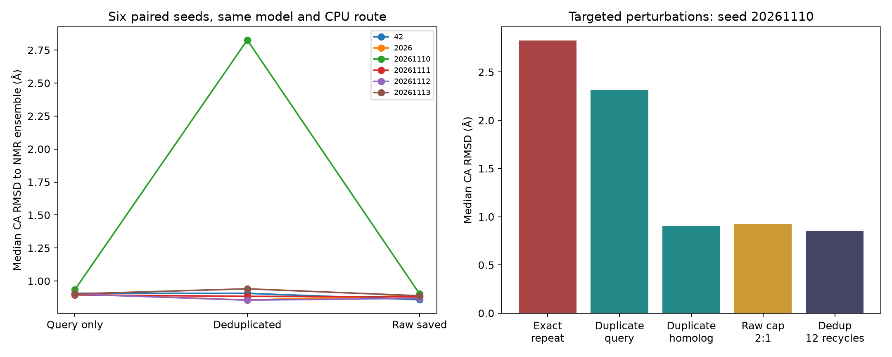
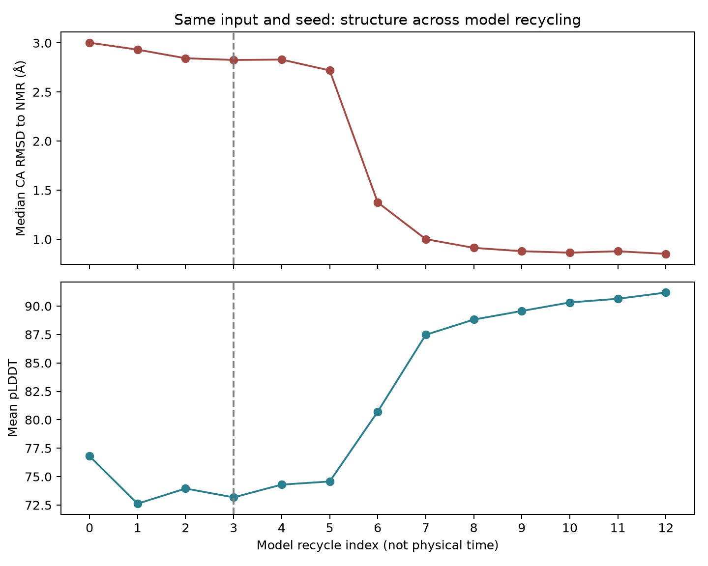

# 去重 MSA 异常：从可复现现象到处理机制

日期：2026-11-10。对象：20 aa Trp-cage（1L2Y），ColabFold 1.6.3 / alphafold-colabfold 2.3.20，model_1_ptm，无模板、无弛豫，CPU。本文是一项针对已观察异常的探索性诊断，不是预先独立验证的普遍规律。所有原始结果保留，没有用后来的较好结果替换异常模型。

## 核心结论

**异常可精确复现，是真实的内部/C端构象偏差；本地预处理会因重复序列和MSA行数改变输入特征及随机掩码。该特定输入/种子的异常在增加recycle后显著改善，但现有实验不能把变化唯一归因于某一个内部步骤。**

不能得出“MSA有害”“去重错误”“重复序列越多越好”或“所有模型都应运行12次recycle”。本例只含两条不同序列，具有很浅的进化信息，且是已知历史短肽，不是训练集外泛化基准。

## 1. 排除伪异常

最初三种输入各运行三个种子。去重输入seed20261110的平均pLDDT为73.1745，对全部38个NMR模型的Cα RMSD中位数为2.826 Å；同条件另两个种子约0.856–0.907 Å。

本轮在新的输出目录精确复跑该条件。**Cα坐标、pLDDT、PAE、pTM均与原异常逐值一致**。输入序列、模型权重、输出哈希、实际recycle 0–3和配置均检查通过，没有读错序列、静默跳过推理或拿错输出的证据。

此外用Bio.PDB独立核对RMSD，最大差约9.19e-8 Å。只使用位置3–18独立拟合后，异常模型内部RMSD中位数仍为2.856 Å，其他八个原始模型为0.556–0.679 Å。不依赖叠合的内部距离矩阵MAE为0.921 Å，同种子query/raw约0.365/0.330 Å。因此不是只由末端误差或全局叠合方式造成。

## 2. 模型真正看到的输入

Q表示query，H表示唯一不同的homolog。

| 输入表示 | 处理后真实行 | 不同序列数 |
|---|---|---:|
| 原始保存文件 Q,Q,H,H | Q,H,H | 2 |
| 按序列去重 | Q,H | 2 |
| 新增重复query对照，header互异 | Q,Q,H | 2 |
| 新增重复homolog对照，header互异 | Q,H,H | 2 |

本地ColabFold首先按header与sequence共同去重：原始两个query的名称/序列相同被合并，两个同源序列名称不同而保留。本地alphafold-colabfold的后续流程关闭了按序列再次去重，故重复H确实参与特征构造。这不是所有AlphaFold版本的共同规则；[DeepMind原版实现](https://github.com/google-deepmind/alphafold/blob/main/alphafold/data/pipeline.py)保留了序列级去重。

由实际导出的特征可见：原始输入中Q/H的列频率权重为1/3与2/3，去重后为1/2与1/2。真实行数也改变后续recycle的随机数偏移和被掩码的位置，**同seed不等于不同形状输入使用相同mask**。例如seed20261110第1次recycle，query被mask的位置分别为raw的2/10/11/17/18和dedup的1/2/20。

45组不加载权重的纯特征处理保留了数组与源码哈希。raw与“重复H”三个种子的保存特征逐元素相同；raw与“重复Q”形状及BERT mask相同，但序列特征/profile不同。具体定位、版本和边界见 [源码诊断](MSA源码诊断.md)。

## 3. 有判别力的干预实验

以下均使用seed20261110。RMSD为相对全部38个NMR模型的Cα叠合RMSD中位数，不挑最接近的NMR模型。

| 干预 | 实际主MSA容量 | recycle上限 | 平均pLDDT | RMSD（Å） |
|---|---:|---:|---:|---:|
| 精确复跑去重Q,H | 2 | 3 | 73.17 | 2.826 |
| 只重复Q：Q,Q,H | 3 | 3 | 74.20 | 2.315 |
| 只重复H：Q,H,H | 3 | 3 | 88.79 | 0.902 |
| 原始输入，容量限制2:1 | 2 | 3 | 87.25 | 0.927 |
| 去重Q,H，更多recycle | 2 | 12 | 91.19 | 0.851 |

可以得出的诊断：

- 重复H与原始raw的坐标、pLDDT、PAE完全相同，支持“送入模型的输入相同”这一源码与特征判断。
- 同为3行的重复Q仍偏差较大，说明“数组尺寸大一点就恢复”不足以解释结果。
- raw容量限制为2仍较好，说明主MSA容量2本身不是充分原因。不过该操作使剩余H进入extra分支，会改变聚类/特征；不能称为只改变尺寸的单变量实验。
- 去重输入本身并未永久失去生成接近NMR构象的能力：同一seed增加recycle后改善。但更多recycle也增加MSA重采样次数，不能把原因唯一归为“迭代数量”或“遇到另一张mask”。



## 4. 保存每一步坐标，确认改善不只是置信度上升

对12-recycle条件另外运行一次，启用官方 `--save-recycles` 保存全部13个阶段（索引0–12）。核验结果：第3阶段与原异常坐标完全相同，第12阶段与前一项12-recycle实验完全相同，保存中间结构没有改变最终结果。

| recycle索引 | 平均pLDDT（PDB四舍五入值） | NMR集合RMSD中位数（Å） |
|---:|---:|---:|
| 0 | 76.80 | 3.002 |
| 3 | 73.17 | 2.826 |
| 5 | 74.57 | 2.719 |
| 6 | 80.71 | 1.375 |
| 7 | 87.47 | 1.001 |
| 8 | 88.81 | 0.913 |
| 12 | 91.19 | 0.851 |

第6–8阶段发生明显的结构偏差下降，置信度同时上升。这解释了为什么原先截在3次recycle时留下异常。**这些索引不是物理时间、MD帧或真实折叠路径**；模型中间输出也不是热力学中间态。12阶段结果保留为干预实验，原3阶段模型仍是原实验结果。



## 5. 偏差具体发生在哪里

结构诊断显示主要变化集中在12–16位及C端相对位置，4–8位的局部φ/ψ仍较接近NMR。P12的ψ角与NMR差异中位数约129.8°；全局拟合下12–16位的Cα位移约3.83–5.19 Å。

Y3–P19侧链重原子最短距离由NMR集合的3.821–4.729 Å变为异常模型的9.132 Å，提示这两处原本相邻的结构区域分开。W6–P12反而缩至2.209 Å，提示未弛豫模型局部挤压；距离更短不能解读为相互作用更强。其他较低RMSD对照也有局部键距异常，低Cα RMSD不等于原子几何完全合格。

这些是几何证据，不足以证明“某个接触断裂导致模型失效”或网络重现了真实折叠机制。详细二面角、距离矩阵、独立复算与几何筛查见 [结构诊断](MSA结构诊断.md)。

## 6. 扩展到六个种子，避免只研究最差的一个

在执行前固定新增三个seed：20261111、20261112、20261113，三种条件全部新增，形成3×6共18个同条件比较。

| 条件 | seed数 | 每seed的NMR中位RMSD范围（Å） | 六seed的中位数（Å） |
|---|---:|---:|---:|
| Query-only | 6 | 0.895–0.935 | 0.902 |
| 去重MSA | 6 | 0.855–2.826 | 0.895 |
| 原始MSA | 6 | 0.858–0.902 | 0.884 |

新增三个seed的去重结果均接近其他正常运行。去重组并非普遍较差，异常仍只出现在此次六个seed中的一个。不能把1/6称为真实失败概率，也不能用38个相关的NMR模型增加统计样本量。模型只有一个，体系只有一个，未做总体显著性或跨靶点准确率结论。

## 7. 可以写进简历的已完成内容

> 针对20 aa短肽结构预测异常，设计3种MSA输入×6个随机种子的对照及针对性复测，追踪MSA去重、重复行权重与随机特征处理；通过独立结构计算、38模型NMR对照及逐recycle坐标分析，复现并定位异常，明确参数敏感性与结论边界。

面试可按“发现异常→排除分析错误→检查模型真实输入→设计干预→观察结构变化→限定结论”的顺序讲。不能写成发现了AlphaFold通用缺陷或验证了蛋白真实折叠机制。

## 8. 可复算证据

本轮新增14次短CPU对照（约62秒累计子进程墙钟时间）和1次保存recycle坐标的短推理；原始9次仍保持不变。三种条件的6种子主比较18次，另外5次定向干预及1次坐标追踪不当作独立种子重复。本专题CPU计算期间，MD和Vina任务保持暂停；晚间另启的正式远端实验见总报告。

- `results/prediction_msa_diagnosis/followup/plan.json`：14次实验开始前保存的后续协议；它本身是观察原异常后的探索性设计。
- `followup/summary.json`、`targeted_results.csv`、`six_seed_panel.csv`：全部对照、精确重复及6种子结果。
- `recycle_trace/`：后验坐标追踪协议、运行日志、每阶段PDB、逐阶段CSV、与原始阶段3/12的一致性核验。
- `features/`：45组纯特征处理、输入与源码哈希；不含权重。
- `structure/`：9个原始预测的独立结构诊断，全部38个NMR参考，不混用后续较好结果。

现有结果分析命令（不启动预测）：

```bash
.conda/bin/python scripts/analyze_msa_followup.py
.conda/bin/python scripts/trace_msa_recycling.py
.conda/bin/python scripts/analyze_msa_outlier_structure.py
```

新推理需要对应运行脚本显式 `--execute`；已有结果目录有哈希保护，拒绝覆盖不完整或改变的证据。预测GPU跨平台桥接未执行；正式MD重复已在后续硬件会话完成，详见总报告，未混入本预测专题。
