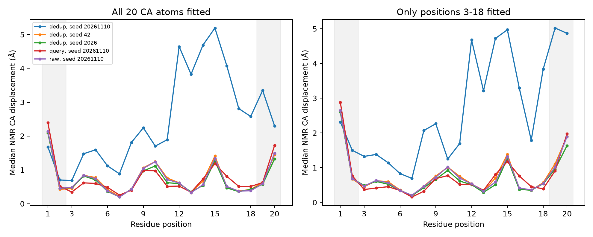
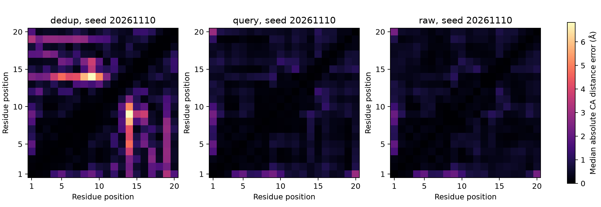
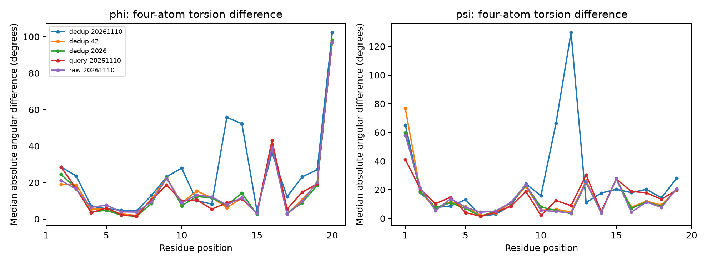

# MSA 消融异常模型的结构诊断

本诊断只读取已经完成的 9 个 ColabFold 模型，不新增推理、MD 或对接。异常模型为 `deduplicated_saved_msa / seed_20261110`；其余两个去重 MSA 种子与相同种子的 query-only、raw-MSA 模型均保留作对照。对 1L2Y 的全部 38 个 NMR 模型分别计算，不挑选最接近的参考模型。

## 结论

异常不是序列读错、RMSD 实现错误，也不只是末端位置差异导致的拟合假象。位置 3-18 单独拟合后，该模型的内部 Cα RMSD 中位数仍为 **2.856 Å**，远高于其他八个模型的 **0.556-0.679 Å**。不依赖叠合的内部 Cα 距离误差也增大。变化主要涉及 **12-16 位及 C 端相对位置**；N 端 4-8 位的局部 φ/ψ 与 NMR 比较接近。这里的“位置 3-18”只是内部位置子集，不是经化学定义的整个疏水核心。

能确认的是这一次输出发生了不同的几何排列；现有坐标不能证明随机特征处理的具体因果路径，也不能把它命名为某个热力学中间态或折叠失败机制。

## 独立计算与输入排查

- 9 个 PDB 均为单链、残基 1-20，序列均为 `NLYIQWLKDGGPSSGRPPPS`；骨架 N/CA/C/O 齐全，没有非有限坐标或有歧义的 altloc。
- 所有输入 PDB 校验和与各运行 manifest 一致；来源哈希保存在 `structure/summary.json`。
- 用 **Bio.PDB.Superimposer** 独立复算 9 × 38 个全 Cα 拟合 RMSD，与原 NumPy Kabsch 实现最大差异 **9.19×10⁻⁸ Å**。
- φ 使用 `C(i-1), N(i), CA(i), C(i)`；ψ 使用 `N(i), CA(i), C(i), N(i+1)`。自编投影四点公式与 Bio.PDB 的 `calc_dihedral` 全部核对，最大环形角差 **5.20×10⁻¹²°**。1 位 φ 和 20 位 ψ 无定义，不补造数值。
- 3 项几何测试覆盖刚体变换下距离矩阵不变性、已知 ±90°/180° 二面角及共线四点拒绝。

## 拟合方式是否放大了异常

下表均先对每个 NMR 模型计算，再取 38 个模型的中位数。距离矩阵 MAE 使用不含对角线的上三角距离对，单位均为 Å。

| 条件 / 种子 | 全20拟合，全20 RMSD | 全20拟合，3-18 RMSD | 仅3-18拟合，3-18 RMSD | 3-18距离矩阵 MAE |
|---|---:|---:|---:|---:|
| dedup / 20261110 | 2.826 | 2.967 | 2.856 | 0.921 |
| dedup / 42 | 0.907 | 0.775 | 0.679 | 0.335 |
| dedup / 2026 | 0.856 | 0.705 | 0.612 | 0.325 |
| query / 20261110 | 0.935 | 0.692 | 0.610 | 0.365 |
| raw / 20261110 | 0.902 | 0.752 | 0.654 | 0.330 |

去掉末端对拟合的影响后，异常依然存在。其全20距离矩阵 MAE 为 **0.985 Å**，同种子 query/raw 为 **0.476/0.436 Å**；内部距离矩阵误差也同向增大。因此并非仅由选择哪组原子叠合造成。



全20拟合下，异常模型 P12/S13/S14/G15/R16 的 Cα 位移中位数分别约 **4.64/3.83/4.69/5.19/4.07 Å**。仅3-18拟合后，相应值仍为 **4.68/3.22/4.72/4.97/3.29 Å**。不同拟合也明显改变 P19/S20 的表观偏差，因此不应只凭全局叠合后的单个残基误差解释局部柔性。



## 局部骨架变化

最显著的内部二面角差异包括：

| 残基 / 角度 | 异常模型角度 | NMR 环形均值 | 与38模型的绝对角差中位数 |
|---|---:|---:|---:|
| G11 ψ | 166.3° | -126.2° | 66.4° |
| P12 ψ | 102.4° | -26.4° | 129.8° |
| S13 φ | -23.2° | -77.7° | 55.8° |
| S14 φ | -143.8° | -95.2° | 52.3° |

这些变化与 12-16 位的空间重排相一致。相反，异常模型 4-8 位的 φ/ψ 与 NMR 的绝对角差中位数约为 **1.6-13.0°**，没有证据说整条肽的 N 端局部构象全面瓦解。这里没有做 DSSP 氢键辅助二级结构分配，因此不把仅靠 φ/ψ 的观察写成正式二级结构分类。



## 指定侧链距离

定义为两残基侧链重原子间的最小欧氏距离，排除 N、CA、C、O、OXT 和氢。每个模型选择实现最短距离的原子对，具体原子名保留于 CSV。下列数字不是氢键或作用能。

| 配对 | NMR 38模型范围 | NMR 中位数 | dedup异常 | 同种子query | 同种子raw |
|---|---:|---:|---:|---:|---:|
| W6-P12 | 3.534-3.754 | 3.588 | 2.209 | 2.614 | 2.899 |
| W6-P18 | 3.691-4.066 | 3.831 | 3.079 | 3.969 | 4.139 |
| Y3-P19 | 3.821-4.729 | 4.229 | 9.132 | 4.951 | 4.613 |

异常模型的 Y3-P19 分离最明显，W6-P12 与 W6-P18 反而更近。不能将“距离更短”写成相互作用更强；特别是 W6-P12 的非键合碳原子最近距离仅约 2.21 Å，提示未弛豫坐标存在局部挤压，需要正式几何/能量检查。其他对照的 W6-P12 距离也低于此次 NMR 集合范围，因此这类局部问题不专属于异常种子。

## 连续性和粗几何筛查

异常模型相邻肽键 C-N 距离 **1.192-1.513 Å**，相邻 Cα 距离 **3.714-4.011 Å**，未触发本次宽松的 C-N `[1.15,1.55] Å` 或 Cα `[3.5,4.1] Å` 筛查，也未出现非相邻残基重原子距离低于 1.5 Å 的极端重叠。由此未见明显断链，但**这不是“局部几何全部合格”认证**。

其他八个未弛豫模型反而存在部分 C-N 过短（最短约 1.10 Å），query-only 的 19-20 Cα 距离约 4.12 Å。这些具体记录保留于 JSON；不能因为模型 Cα RMSD 较低就忽略原子几何问题。本次未做 MolProbity、全套键角/手性检验、弛豫或能量比较。

## 可复算文件与边界

运行：

```bash
.conda/bin/python scripts/analyze_msa_outlier_structure.py
.conda/bin/python -m unittest discover -s tests -p test_msa_outlier_structure.py -v
```

输出目录 `results/prediction_msa_diagnosis/structure/`：

- `summary.json`：源哈希、独立验证、9模型摘要及局部几何筛查。
- `per_reference.csv`：9 × 38 参考模型的独立 RMSD/距离误差。
- `per_residue.csv`：两种拟合与距离轮廓的逐残基偏差。
- `distance_pairs.csv`：每个 Cα 距离对的原值和 NMR 偏差。
- `dihedrals.csv`：实际 φ/ψ、参考环形均值及环形差异。
- `sidechain_contacts.csv`、`nmr_sidechain_contacts.csv`：指定侧链最短距离及完整 NMR 参考分布。

这是观察到异常后进行的描述性诊断，不是事先登记的机制验证。38 个 NMR 模型不是38次独立实验，三个随机种子也不足以估计低概率事件频率。结果支持“该输出的内部与 C 端排列显著不同”，不支持“去重 MSA 必然破坏某个结构核心”或“网络走入确定的折叠中间态”。
