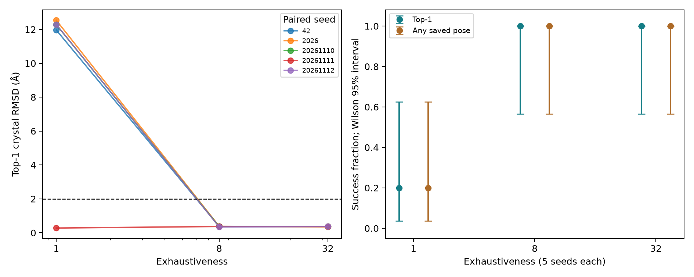
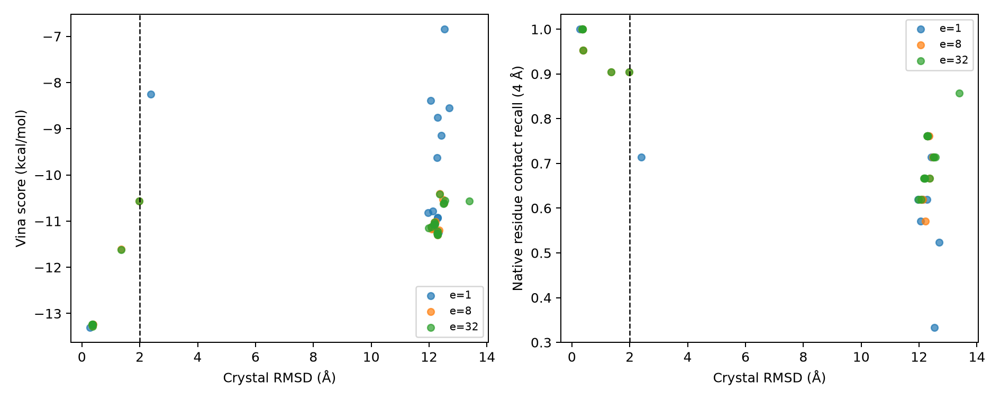

# 1IEP重对接：搜索强度与随机种子的配对实验

2026-11-10在M3 Max上完成预定的15次运行，保存57个姿势。结果见[`summary.json`](../results/docking_benchmark_m3/summary.json)、[`run_summary.csv`](../results/docking_benchmark_m3/run_summary.csv)及[`all_poses.csv`](../results/docking_benchmark_m3/all_poses.csv)。这是一套准备好的共晶体系上的方法验证，不能代表跨靶点准确率或亲和力预测能力。

## 实验控制与核验

固定受体、配体、盒子、打分函数、`num_modes=9`、`energy_range=3`与每次Vina的`cpu=1`，仅改变`exhaustiveness=1/8/32`，每组使用相同五个seed：42、2026、20261110、20261111、20261112。协议先于运行写入；原本地六次探索结果保留，未混入本批次。M3同机同环境、两个任务并行，耗时只描述此次配置，不是跨机器性能基准。

全部姿势对共晶配体计算对称性校正的重原子RMSD，保持受体坐标系，不对配体单独叠合。spyrmsd结果再用RDKit图映射枚举与NumPy独立核算，57个姿势误差均小于`1e-8 Å`；输入、输出哈希及原始日志一并保留。依赖与平台见[`host_provenance.json`](../results/docking_benchmark_m3/host_provenance.json)及同目录环境清单。

## 预定指标的结果

成功定义为晶体重原子RMSD ≤ 2 Å；Top-1取最低打分姿势，Any-saved取全部保存姿势中是否至少存在一次命中。

| Exhaustiveness | Top-1成功 | Any-saved成功 | Top-1 RMSD中位数（Å） | Vina耗时中位数（秒） |
|---|---:|---:|---:|---:|
| 1 | 1/5 | 1/5 | 12.286 | 5.00 |
| 8 | 5/5 | 5/5 | 0.371 | 33.92 |
| 32 | 5/5 | 5/5 | 0.371 | 135.98 |

成功率的描述性Wilson 95%区间分别为3.6%–62.4%、56.6%–100%、56.6%–100%。每组仅五个种子，区间很宽；这些区间不包含靶点选择或结构准备的不确定性。

在这五个配对种子中，搜索强度从1增加至8使四个失败seed变为成功，另一个保持成功；从8增加至32没有增加成功次数，耗时中位数约增至四倍。因此，本体系支持“最低搜索强度对种子敏感；继续增大搜索强度的边际收益有限”，不能证明8是所有任务的最优参数。

## 三个值得解释的细节

1. **单个最好结果会掩盖不稳定性。** `e=1, seed=20261111`的Top-1 RMSD为0.281 Å，甚至低于本批次所有高强度运行；但该组其余四个seed全部失败。挑出这一条就无法看见1/5与5/5的差别。
2. **接触恢复不等于姿势正确。** `e=1, seed=20261110`的Top-1 RMSD为12.286 Å，却恢复了21个参考残基接触中的16个（76.2%）；几何接触只说明靠近哪些残基，不完整描述配体取向，也不等于氢键或亲和力。
3. **本批次没有严格的“命中已保存但排序第一失败”案例。** Top-1和Any-saved成功数相同。上述seed的第4名姿势RMSD为2.389 Å，比第1名明显更近，但仍未达到预先规定的2 Å阈值，不能事后放宽阈值把它称为成功。其余失败输出也不能证明搜索过程从未到过正确姿势，因为保存数量和能量窗口会过滤输出。

## 可用于简历与面试的表述

完成1IEP共晶体系3档搜索强度×5个配对种子的重对接实验，对57个保存姿势独立核验对称性校正RMSD，并结合残基接触分析种子敏感性；区分单次最优结果、重复成功率和有限输出对采样/排序诊断的限制。

这里的“独立核验”指两种几何计算实现交叉检查，不代表独立实验数据集。项目没有用这15次运行验证药效、真实结合自由能或跨靶点泛化。
