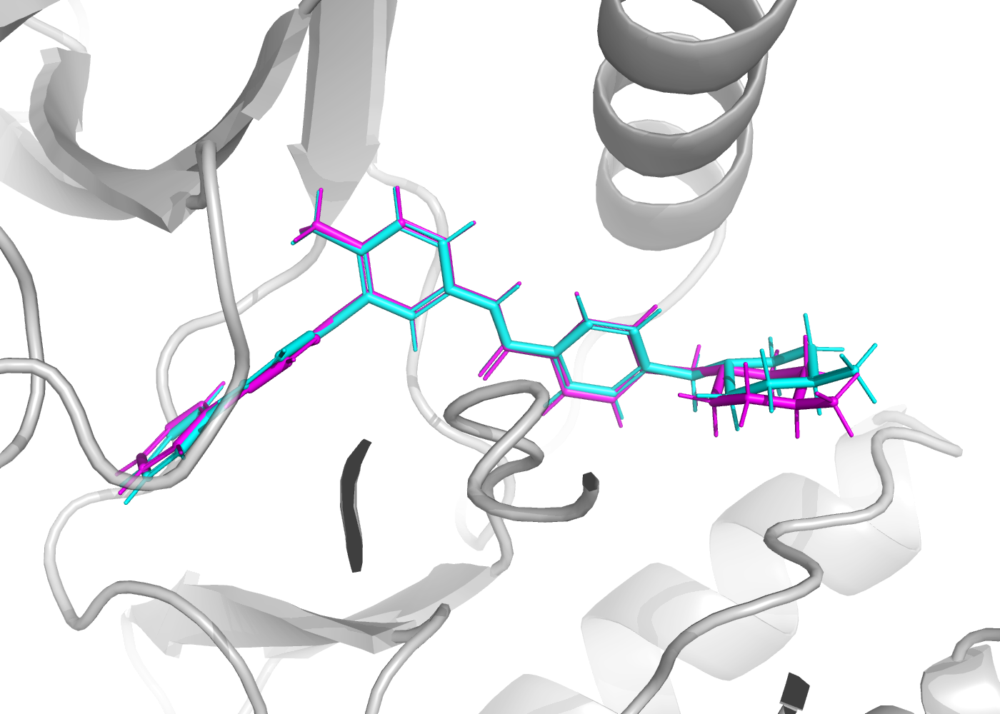
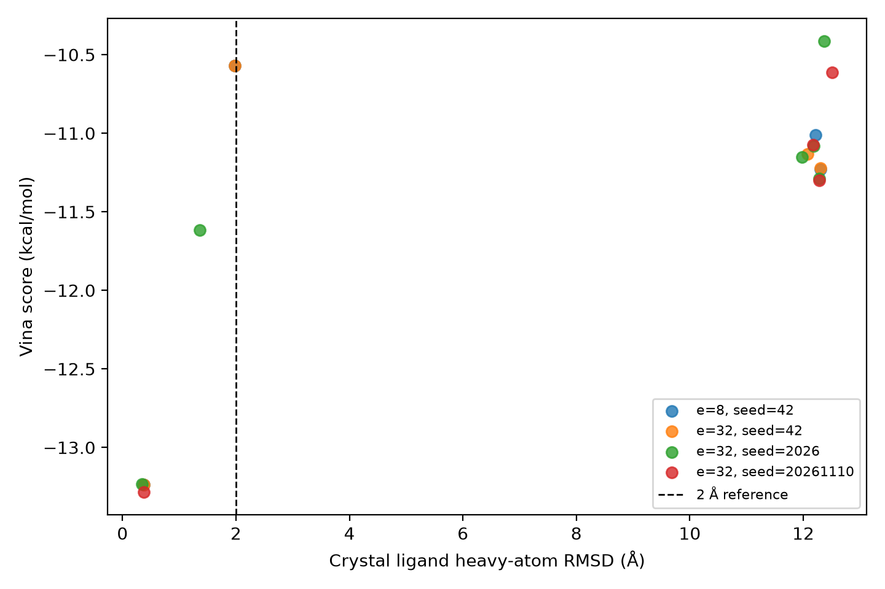
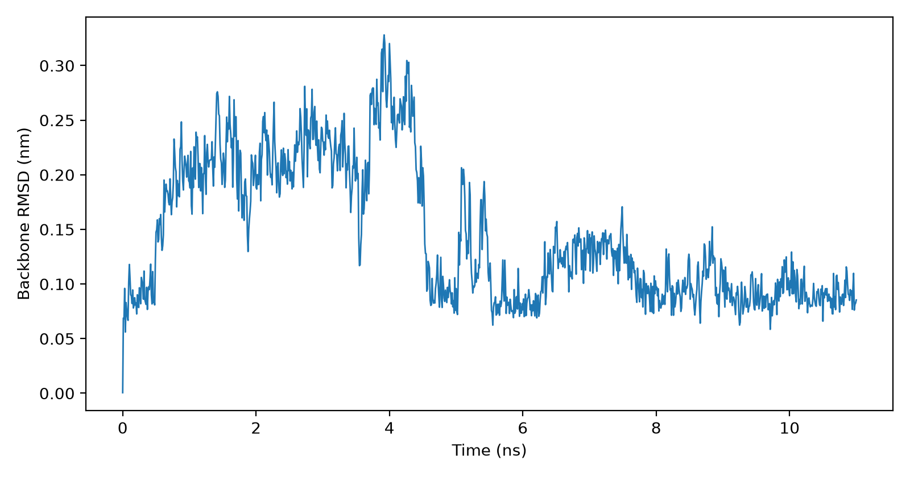
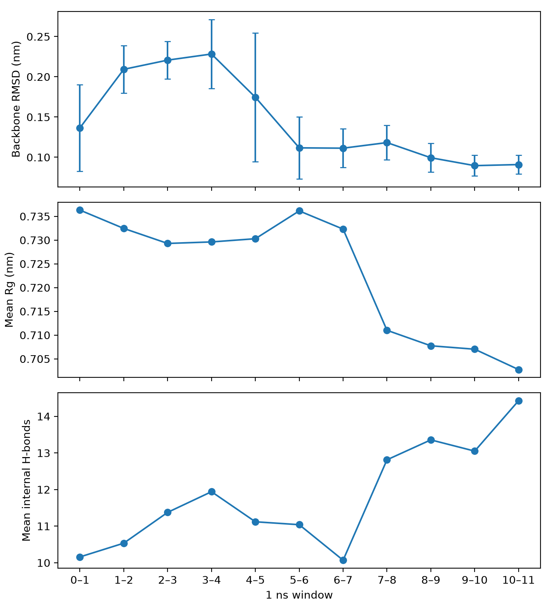
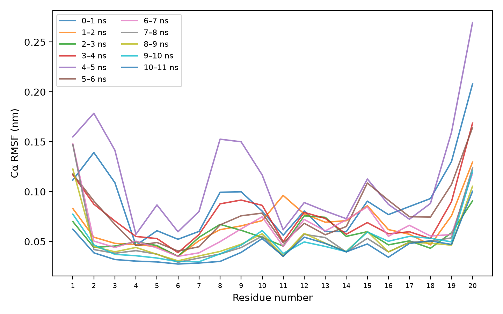
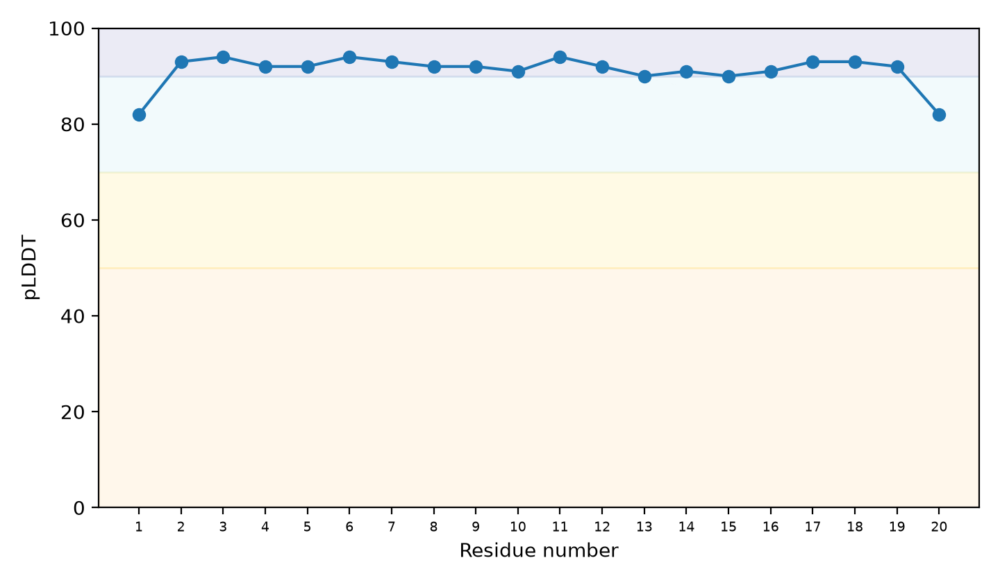
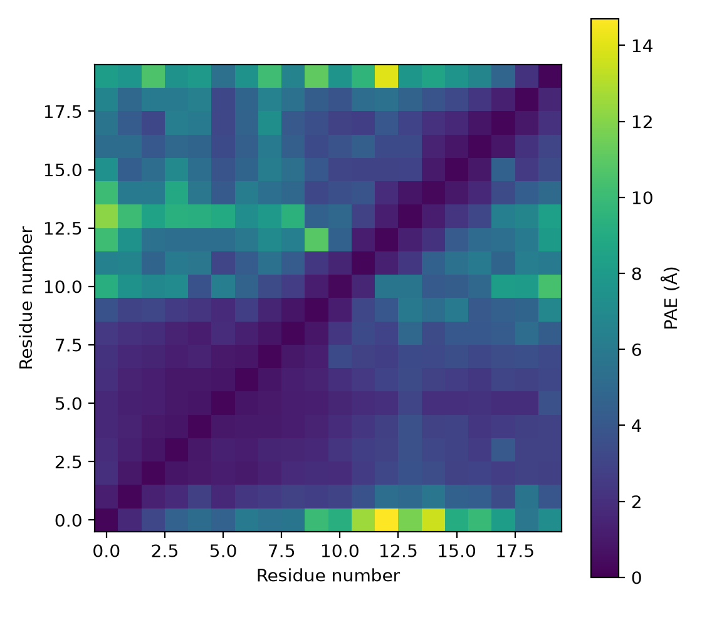
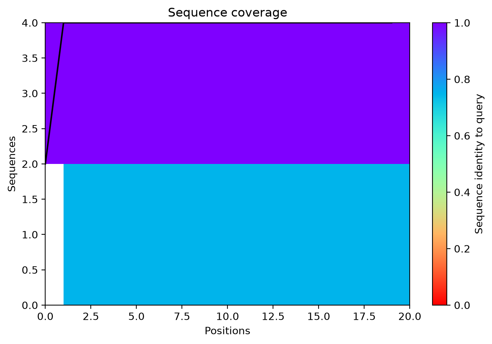

# 计算方法验证型小项目技术报告

日期：2026-11-10　平台：Apple M4 / macOS 27.0.1（arm64）

## 摘要与目标

本项目验证三类常用计算方法的完整操作与结果判读：以 1IEP 共晶体系评价 AutoDock Vina 重对接，以 1L2Y 短肽演示 GROMACS 模拟与四项轨迹分析，并用实际 ESMFold 输出与 ColabFold 官方文档学习 pLDDT、PAE 的边界。项目目标是方法学习和可复现，不是药物筛选或机制发现。

## 数据与方法

**对接。** 受体为 c-Abl 激酶（PDB 1IEP），配体为 imatinib/STI。原始 PDB 含 A/B 两链及两份配体；实际使用官方教程准备好的 A 链受体（无 HETATM）和 A 链配体 SDF。原始 PDB 来自 RCSB；已加氢受体和保留键级的配体 SDF 来自 Vina 官方基础教程。Meeko 0.8.0 生成刚性受体和配体 PDBQT；配体质子化沿用教程输入，未宣称枚举全部互变异构/质子化状态。Vina 1.2.7 使用 20 × 20 × 20 Å 盒子，中心 `(15.190, 53.903, 16.917)`，`num_modes=9`、默认 `energy_range=3 kcal/mol`、4 CPU。主运行 `exhaustiveness=32`，种子 42、2026、20261110；对照为种子 42、搜索强度 8。`num_modes` 是上限，能量窗口过滤后 4 次运行分别保存 4/4/6/4 个，共 18 个姿势。

所有导出 SDF 姿势去除氢原子，按分子图建立参考—预测原子对应，再用 spyrmsd 0.9.0 计算对称性校正的晶体配体重原子 RMSD；不做居中或最优叠合。最高打分与最低 RMSD 分开报告，2 Å 仅作常用参考线。PyMOL 3.1.0 用于盒子和叠合检查。

**MD。** 取 1L2Y 第 1 个 NMR 模型（20 aa）。GROMACS 2026.4 使用 AMBER99SB-ILDN/TIP3P、立方盒和 1.0 nm 最短溶质—盒壁距离，体系含 304 个短肽原子、2678 个水分子及 1 个 Cl⁻。最陡下降最小化至 Fmax < 100 kJ mol⁻¹ nm⁻¹；100 ps NVT、100 ps NPT 均有位置约束，随后进行无位置约束生产模拟，从 1 ns 连续续跑至 6 ns 和 11 ns。步长 2 fs，约束含氢键，PME，V-rescale 300 K，C-rescale 1 bar；NVT 速度生成和随机项种子为 20261110，续跑不重新生成速度。轨迹每 10 ps 输出一帧。

分析前依次执行 PBC 分子完整化/居中和骨架旋转平移叠合。指标为骨架 RMSD、逐残基 Cα RMSF、蛋白回旋半径与蛋白内部氢键数。RMSD 参考为 `md.tpr` 中的生产起始结构（NPT 末态），不是原始 NMR 坐标；氢键使用 GROMACS 默认 0.35 nm/30° 判据。完整 MDP 和交互选择见 `config/`、`scripts/run_md.sh`。

**结构预测。** 将同一 20 aa 序列提交 ESM Atlas `foldSequence/v1/pdb` 接口，获得 ESMFold v1 PDB；从 Cα B-factor 读取 pLDDT，并按该接口的 0–1 标度转换为 0–100。ColabFold 1.6.3 在 CPU 上实际运行 `alphafold2_ptm`，使用 MMseqs2 UniRef+Environmental MSA、1 个模型、3 次 recycle、种子 20261110，无模板或 Amber relaxation；保存 PDB、PAE JSON、pLDDT、PAE 和 MSA coverage。

## 结果

### 重对接

| 搜索强度 | 种子 | 最高打分（kcal/mol） | 该姿势 RMSD（Å） | 最低 RMSD（Å） |
|---:|---:|---:|---:|---:|
| 8 | 42 | -13.237 | 0.378 | 0.378 |
| 32 | 42 | -13.237 | 0.378 | 0.378 |
| 32 | 2026 | -13.233 | 0.347 | 0.347 |
| 32 | 20261110 | -13.285 | 0.371 | 0.371 |

四次最高打分姿势的对称性校正 RMSD 均低于 2 Å；种子 42 的普通重原子 RMSD 经 NumPy 独立重算为 0.90573 Å，对称性校正后为 0.37786 Å。其他姿势 RMSD 可达约 12 Å 而打分仍约 -10 至 -12 kcal/mol，因此不能只展示最低打分。本例搜索强度 8 与 32 的最高打分结果一致，只是单体系观察，不证明默认参数普遍足够。

### MD

初始 1 ns 的 RMSD 后半段上升；续到 6 ns 后，最后三个窗口均值仍为 0.228、0.175、0.112 nm，未满足预设平台判据，因此继续原轨迹至 11 ns。合并轨迹经 `gmx check` 确认为 1101 帧，覆盖 0–11000 ps、10 ps/帧。三个阶段平均温度为 300.008、299.993、299.986 K；平均压力为 10.79、3.18、0.48 bar，瞬时压力波动约 260 bar。

| 1 ns 窗口 | RMSD 均值（nm） | 窗口内 RMSD 斜率（nm/ns） | Rg 均值（nm） | 氢键均值 | RMSF 均值（nm） |
|---|---:|---:|---:|---:|---:|
| 8–9 ns | 0.099 | 0.022 | 0.708 | 13.36 | 0.052 |
| 9–10 ns | 0.090 | 0.007 | 0.707 | 13.05 | 0.050 |
| 10–11 ns | 0.091 | -0.007 | 0.703 | 14.43 | 0.044 |

末段 RMSD 均值极差约 0.010 nm，窗口内漂移明显减弱，满足本项目预先设定的描述性平台判据；RMSF 也总体降低。准确结论是“延长采样后末段出现平台化迹象”，不是已证明热力学收敛、折叠或结合机制。6 ns 与 11 ns 的窗口表均保留，避免只展示有利时间段。

### 结构预测置信度

ESMFold 的 20 个残基平均 pLDDT 为 91.15；第 1 和 20 残基均为 82，低于内部多数残基。ColabFold 平均 pLDDT 为 85.30，但 pTM 仅 0.11；平均 PAE 3.85 Å、最大 14.70 Å，实际 MSA 深度很低（max_seq=4、max_extra_seq=1）。因此局部置信度尚可并不等于整体折叠或相对位置可靠。ESMFold 不使用 MSA，且本接口不提供 PAE。任何配体结合构象、口袋侧链、质子化、关键水和动态机制仍需其他证据。

## 失败点与排查

1. 系统 Python 3.9 无匹配 Vina wheel，源码构建因缺 Boost 失败；改用 conda-forge 原生 arm64 环境。
2. 项目路径含空格，Meeko 入口 shebang 截断路径；改为显式 `.conda/bin/python <脚本>`。
3. setuptools 84 不再提供 ProDy 所需 `pkg_resources`；固定 setuptools 80.9.0 并保留环境清单。
4. 参考/预测 SDF 原子顺序不同导致 RMSD 断言失败；加入分子图原子映射，而非按数组位置直接计算。
5. 初用 `spyrmsd.rmsd` 并未做对称性校正；改用 `symmrmsd` 和邻接矩阵，并由 RDKit 枚举 4 个映射独立复核。
6. `num_modes=9` 只是上限，默认能量窗口过滤后实际为 18 个姿势；修正计数并显式记录 `energy_range=3`。
7. GROMACS 加离子前出现预期净电荷警告，仅在该步骤使用 `-maxwarn 1`；含氢键约束已补齐。随后修正 `posre.itp` 相对拓扑目录的包含路径。
8. ESMFold 返回 pLDDT 观测为 0–1，初读均值为 0.9115；按 ESMFold 约定转换为 91.15。
9. 额外以种子 42 复跑一次 Vina，PDBQT SHA-256 与首次运行完全相同；该次仅作确定性检查，不计入四次参数对照。
10. 6 ns 时 RMSD 仍未平台化，未删帧或改判据；继续至 11 ns 后才出现末段平台化迹象。
11. GROMACS `-noappend` 产生 `part0002/part0003` 文件，后处理按实际名称整理，未重跑已完成的轨迹。
12. ColabFold 首次权重下载在 72% 处因任务时限中断；不限时重跑后完成。相同种子再次预测的 pLDDT、PAE、pTM 完全一致。

## 结论限制与复现

本例只说明所述输入和参数下重对接姿势接近共晶，不证明 Vina 对其他靶点、质子化或盲对接可靠。11 ns 单条短肽轨迹的末段平台化不能证明采样收敛、折叠、热力学稳定或结合机制；RMSF、氢键和回旋半径也不能互相替代。高 pLDDT/低 PAE 不能替代实验结构及结合验证，本例 ColabFold 的低 pTM 和浅 MSA 更需谨慎。

复跑入口见 `README.md` 与 `scripts/`。数据来源/SHA-256、实际版本、冻结环境、关键日志和逐窗口数值均随项目保存。
