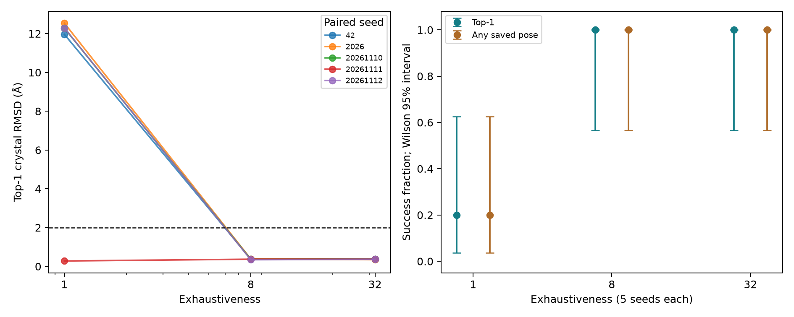
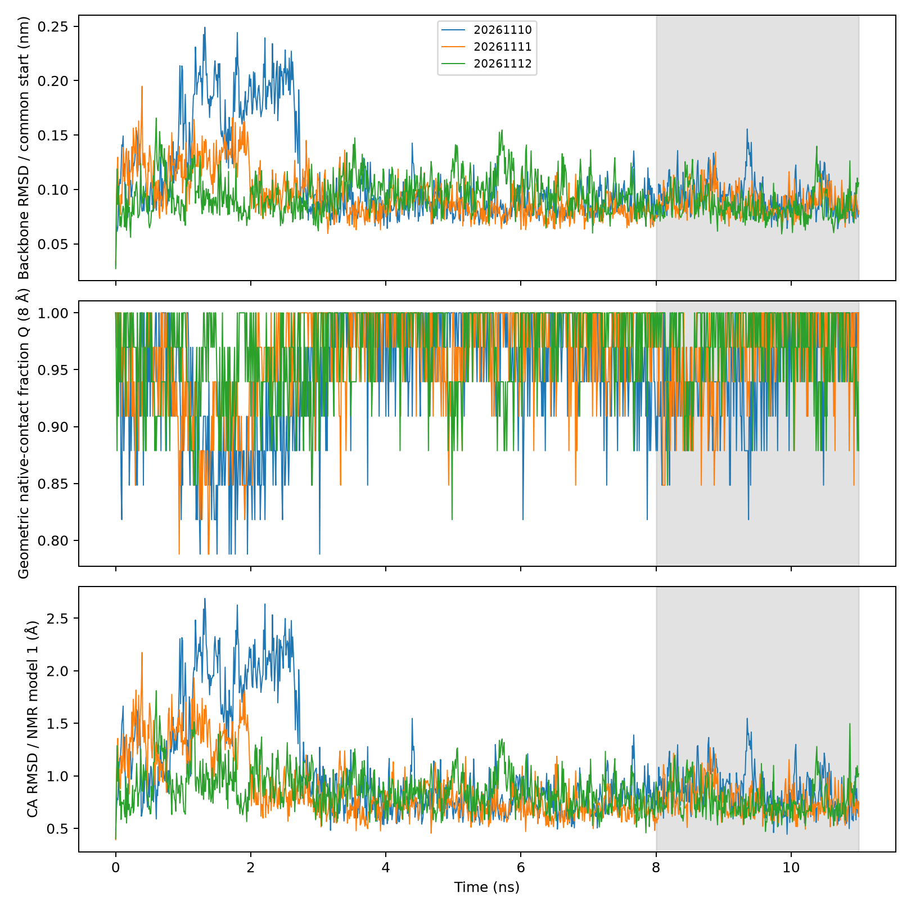
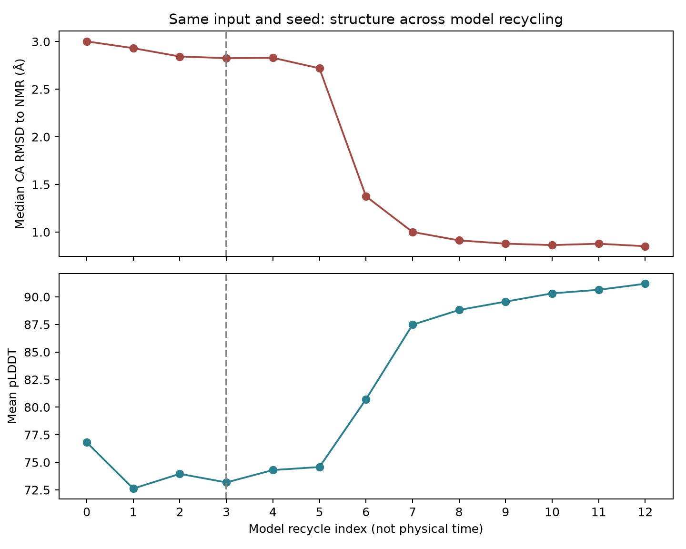

# 计算结构生物学方法验证与敏感性分析

日期：2026-11-11。正式对接：M3 Max / macOS；正式MD：Ubuntu / RTX 4070 Laptop GPU；预测与独立核验：Apple M4 / macOS。项目用于方法学习、验证和可复现实践，不是药物研发管线或结合机制研究。

## 研究问题与实验设计

三项练习分别回答：搜索强度是否影响重对接成功率；单条短肽轨迹的末段表现能否在不同初速度重复中再现；极浅MSA预测异常是否可复现、对哪些处理敏感。1IEP对接与1L2Y MD不是同一体系，后者不是对接复合物稳定性验证。

| 模块 | 已完成实验 | 对照与统计单位 |
|---|---|---|
| 共晶重对接 | 搜索强度1/8/32 × 5个配对seed，15次、57个姿势 | 同受体、配体、盒子与软件；单位为运行，每组n=5 |
| MD | 两批共6条不同初速度 × 11 ns，66 ns生产段；每条另有100 ps NVT和100 ps NPT | 同最小化构象与环境；每批n=3，分批报告 |
| 预测消融 | 3种MSA × 6个seed，18个主比较；另5次定向复测、1次坐标追踪 | 固定model_1_ptm；38个NMR模型不是独立样本 |

历史四次基础对接、一条连续11 ns CPU轨迹、未完成CPU pilot和本地六次探索对接单独保留，不混入新平台正式结果。基础阶段方法和失败记录见[历史报告](legacy/技术报告_基础阶段_20261110.md)。

## 1. 共晶重对接：搜索强度与种子敏感性

**数据与参数。** 1IEP的c-Abl/imatinib体系；原始PDB来自RCSB，实际加氢A链受体和保留键级的配体SDF来自Vina官方教程。Meeko0.8.0制备PDBQT，沿用输入质子化状态，未枚举互变异构体或质子化状态。Vina1.2.7，盒中心(15.190,53.903,16.917) Å，边长20 Å，num_modes=9、energy_range=3 kcal/mol。每次cpu=1，最多两项并发。seed为42、2026、20261110、20261111、20261112，三组配对。

**评价。** spyrmsd0.9.0经分子图映射与对称性校正计算晶体配体重原子RMSD，保持受体坐标系，不单独叠合配体。57个保存姿势均以RDKit图映射枚举和NumPy独立复算，差值小于1e-8 Å。Top-1为最低分姿势，Any-saved为任一保存姿势；成功阈值事先固定为RMSD≤2 Å。

| 搜索强度 | Top-1成功 | Any-saved成功 | Top-1 RMSD中位数（Å） | 耗时中位数（秒） |
|---:|---:|---:|---:|---:|
| 1 | 1/5 | 1/5 | 12.286 | 5.00 |
| 8 | 5/5 | 5/5 | 0.371 | 33.92 |
| 32 | 5/5 | 5/5 | 0.371 | 135.98 |

从1到8使四个失败seed变为成功；从8到32没有增加成功数，耗时约四倍。1/5与5/5的描述性Wilson 95%区间分别为3.6%–62.4%、56.6%–100%，不代表跨靶点准确率。耗时受并发负载影响，不是硬件性能基准。

e=1的一个seed得到全批次最低Top-1 RMSD（0.281 Å），但该组其余四次失败，说明单次最好结果会掩盖不稳定性。另一失败Top-1的RMSD为12.286 Å，却恢复76.2%的参考残基接触，接触恢复不等于取向正确。本批次没有Top-1失败、Any-saved成功案例；有限输出也不能证明搜索从未访问正确姿势。

全部姿势、哈希、环境及本地复算证据见`results/docking_benchmark_m3/`；详见[对接专题](对接配对种子实验.md)。

## 2. MD：原三条探索与新三条验证

**2026-11-11更新。** 新seed20261113/14/15各11 ns已完成并核验，现共六条、66 ns。三条在冻结的1–3 ns窗口均出现比自身8–11 ns末段更大的骨架偏差与Y3–P19侧链距离；seed20261114末段仍有波动。详细数据和六条图见[新种子验证批次](MD新种子验证批次.md)。下列参数和统计表保留原三条批次口径，不能当成六条合并统计。起点×有约束NPT时长对照随后于2026-11-11 22:32完成，新增99 ns；见[四格结果解读](MD四组对照结果解读.md)。四格主体共12条132 ns，含原探索三条则正式总量为15条165 ns；以下旧批次统计不混并。

**系统与控制。** 1L2Y第1个NMR模型，20 aa Trp-cage；AMBER99SB-ILDN/TIP3P，304个短肽原子、2678个水分子、1个Cl离子，立方盒、1.0 nm溶质到盒壁距离。三条从相同minim.gro出发，以seed20261110/11/12生成不同初速度；各100 ps NVT、100 ps NPT，然后11 ns无位置约束生产模拟。步长2 fs、含氢键约束、PME、V-rescale 300 K、C-rescale 1 bar，每10 ps一帧。它们是初速度重复，不是独立起始构象。

**执行与验收。** GROMACS2026.3 conda-forge CUDA，RTX4070 Laptop 8GB。20 ps短模拟先确认GPU工作；正式日志确认PP、PME、更新和约束卸载到GPU。每条达到5500000生产步、1101帧，覆盖0–11000 ps，无LINCS WARNING或Fatal error。原2026.4共同参考TPR由2026.3直接读取，无需替换。生产性能约1474–1505 ns/day，仅描述此小体系与配置。

**分析口径。** 按PBC完整化蛋白；骨架RMSD统一参考历史原始生产起点TPR（NPT末态），另列相对NMR模型1的Cα RMSD。Cα RMSF对每帧向同一NMR模型1旋转平移拟合后，计算相对该窗口平均位置的波动，与历史gmx默认拟合方式区分。Rg及内部氢键用GROMACS分析。内部1 ns窗左闭右开，最终11 ns端点包含一次。

几何天然接触Q以NMR模型1中序列间隔≥3、Cα距离≤8 Å的残基对为参考，轨迹距离≤参考距离1.2倍视为保留；7/9 Å参考集合另作敏感性检查。Q不是热力学折叠概率。原输出heavy_min是全残基重原子最短距离；审核补充真正的侧链距离，两者分别保留，不能混称。

| 预定末段8–11 ns指标 | 三条时间均值的平均 ± 轨迹间SD | 三条时间均值范围 |
|---|---:|---:|
| 共同参考主链RMSD（nm） | 0.08886 ± 0.00377 | 0.08536–0.09285 |
| 蛋白Rg（nm） | 0.70918 ± 0.00199 | 0.70691–0.71061 |
| 内部氢键数 | 12.684 ± 0.086 | 12.588–12.754 |
| NMR模型1 Cα RMSD（Å） | 0.7964 ± 0.0548 | 0.7625–0.8596 |
| 几何Q（8 Å参考集合） | 0.96218 ± 0.01113 | 0.95027–0.97231 |

SD为三条轨迹各自时间均值之间的差异，不是帧级标准误或置信区间。三条末段均保留较高参考接触、共同参考偏差较小，支持该初始结构附近的短时行为有一定重复性；不证明热力学收敛、从头折叠、稳定态概率或结合机制。历史单条自适应延长与本批次预先固定的设计分开解释。

全程均值须同时保留，避免末段掩盖差异：

| seed | 0–11 ns主链RMSD（nm） | 8–11 ns主链RMSD（nm） | 0–11 ns Y3–P19侧链距离（Å） | 8–11 ns侧链距离（Å） |
|---|---:|---:|---:|---:|
| 20261110 | 0.10638 | 0.09285 | 5.0733 | 4.5986 |
| 20261111 | 0.09343 | 0.08838 | 4.3718 | 4.4297 |
| 20261112 | 0.09333 | 0.08536 | 4.2925 | 4.4137 |

第一条全程结构偏差和Y3–P19侧链距离较大；末段接近不能抹去这一差别。NMR模型1的该侧链距离为3.975 Å。三条生产温度均值为299.982/299.941/299.985 K；压力均值1.58/−0.80/−1.05 bar，时间序列SD约259–264 bar，未进行相关时间修正，不能将SD当均值误差。

本地GROMACS2026.4对同一三份轨迹独立后处理，与原Ubuntu2026.3主链RMSD最大差≤1e-7 nm、Rg≤1e-6 nm、氢键完全一致；9个抽帧另用独立SVD及显式接触循环核验通过。坐标导出精度为0.001 nm，多列小数用于复算定位，不代表额外物理精度。

原聚合见`results/md_replicates_gpu/aggregate_analysis/`；本地轨迹/TPR哈希见`local_transfer_verification.json`。审核、全程统计及补充指标见[MD独立重复审核](MD独立重复审核.md)，原输出不覆盖。

### 后验深挖：哪些解释经得住检查

已对原三条轨迹完成38个NMR参考敏感性、去末端独立拟合、无需拟合的内部距离、逐接触变化、时间块/阈值分析、圆二面角及固定时刻快照。1–3 ns第一条偏离对参考/拟合方式稳健；末段细微排名则依赖参考。总体Q早期排名只在6/9种接触定义下保持，不能说第一条在任何指标下均更差。未见独特Y3大转子切换支持简单侧链机制。详见[MD差异深挖与后续验证](MD差异深挖与后续验证.md)。这些是同数据的探索性检验，不是新增独立样本或真实动力学因果证明。

## 3. 极浅MSA异常：保留失败、检查真实输入

**基本实践。** 实际保存ESMFold输出及ColabFold的pLDDT、PAE、pTM、MSA coverage。历史ESMFold/ColabFold平均pLDDT为91.15/85.30，后者pTM0.11需结合20 aa短肽的长度效应解释；两者对38个NMR模型逐一Cα叠合的RMSD中位数为0.807/1.039 Å。已知历史结构不是训练集外评测。

**异常与对照。** ColabFold1.6.3 / alphafold-colabfold2.3.20，固定model_1_ptm、无模板、无relax、CPU、主比较3次recycle。query-only仍是AlphaFold2，不是ESMFold。去重seed20261110的NMR集合RMSD中位数2.826 Å、平均pLDDT73.17；精确复跑坐标、pLDDT、PAE、pTM均相同。内部3–18位独立拟合仍偏差2.856 Å，排除了纯末端假象。

| 主比较条件 | seed数 | 每seed的NMR中位RMSD范围（Å） | 六seed中位数（Å） |
|---|---:|---:|---:|
| Query-only | 6 | 0.895–0.935 | 0.902 |
| 去重MSA | 6 | 0.855–2.826 | 0.895 |
| 原始MSA | 6 | 0.858–0.902 | 0.884 |

**诊断与干预。** 本地实现把原始Q,Q,H,H处理为Q,H,H，按序列去重得到Q,H。重复H改变profile权重，真实行数改变后续随机特征处理；同seed不保证不同形状输入获得相同mask。45组纯特征追踪与源码快照支持这一实现层解释，不能外推所有AlphaFold版本。

同异常seed重复Q得2.315 Å，重复H得0.902 Å；限制raw主MSA容量为2后得0.927 Å，但extra分支也改变，不是纯尺寸实验。去重增加到12次recycle后得0.851 Å；另存全部阶段确认第3阶段复现异常、第12阶段复现改善。第6–8阶段偏差明显下降，但模型迭代不是物理时间或真实折叠路径。更多recycle同时增加MSA重采样，尚未隔离其因果贡献。

去重组六seed仅一个明显异常，不支持“MSA有害”“重复越多越好”或“12次普遍最优”。低Cα RMSD也不能保证原子级结构合格。完整证据见[异常专题](MSA异常深挖报告.md)、[源码诊断](MSA源码诊断.md)、[结构诊断](MSA结构诊断.md)。

## 复现、失败点与结论边界

协议、参数、脚本、逐run结果、来源和哈希随项目保存。重要修复包括原子映射/对称性RMSD、MD窗口重复计数、派生轨迹缓存、预测分析与新推理分离、失败输出保留、同环境校验及指标原子选择核对，详见[审核修订记录](审核修订记录.md)。

README提供复现入口；对接与GPU环境分别锁定，不把macOS清单当Linux锁。大体积轨迹、TPR、检查点与EDR保存在本地证据包，尚未公开上传；仅clone仓库不能直接完成全部原始轨迹后处理。哈希提供追溯性，不承诺跨硬件逐位相同。三页PDF从保存结果生成，专题保留全部失败与限制。

项目可展示方法控制、软件使用、数据核验与异常诊断能力，不能包装成原创算法、真实药物研发管线或产业经验。个人技能表述应以能够独立解释并演示的操作为准。
